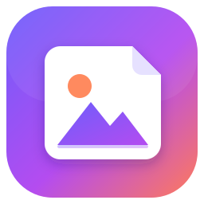

<div align="center">



# Snapdate

**Sort your photos by the day they were taken.**<br>
*Fotos nach Aufnahmedatum sortieren.*


</div>

---

Snapdate is a small, friendly Windows app that takes a folder full of photos —
`IMG_4711.JPG`, `DSC00012.ARW`, `WhatsApp Image….jpeg` — and gives every file
a clean, sortable name based on **when the photo was taken**, e.g.
`2024-07-14_15-32-08.jpg`.

Just download **one file** and double-click it. Nothing to install.

<!-- Screenshots are captured from the real app once M4 is done. -->
<p align="center">
  
</p>
<p align="center">
  
  
</p>

## Features

- 📁 **Pick two folders** — where your photos are, and where the renamed copies go. Drag & drop works too.
- 🕒 **Real capture date** — read from the photo's metadata (EXIF, XMP, QuickTime). If a file has none, its file date is used and clearly marked.
- 🧩 **Build your own name** — click blocks like *Year*, *Month*, *Day*, *Hour*, *Original name*, *Camera* or *Counter* and add separators. `/` creates sub-folders (`2024/07/…`).
- 👀 **Preview first** — see every old → new name before anything happens.
- 🛡️ **Safe by default** — copies instead of moving, never overwrites, adds `(2)` on duplicates, writes a log file.
- 🖼️ **Many formats** — JPG, PNG, HEIC/HEIF, WebP, TIFF, GIF, BMP, RAW (CR2, CR3, NEF, ARW, DNG, ORF, RW2 …) and videos (MP4, MOV). The file type is always kept.
- 🌍 **English & Deutsch** — chosen automatically from your Windows language, switchable any time.
- 🌗 **Light & dark** — follows your Windows setting.
- 🔒 **Private** — works fully offline. No account, no telemetry, nothing leaves your PC.

## Download

Get the latest `Snapdate-vX.Y.Z-win-x64.exe` from
[Releases](../../releases) (use `win-arm64` on ARM devices such as Surface Pro X / Copilot+ PCs).
Verify the download with the published `SHA256SUMS.txt` if you like.

## How to use

1. Start `Snapdate.exe`.
2. **Choose folders** — *Photos from* and *Save renamed copies to*.
3. **Build the file name** — click the blocks or pick a quick preset.
4. Check the preview and press **Copy N photos**.

Detailed guides: [English](docs/user-guide.en.md) · [Deutsch](docs/user-guide.de.md) ·
[All placeholders](docs/placeholders.md)

## Placeholders

| Block | Placeholder | Example |
|---|---|---|
| Year | `{YYYY}` / `{YY}` | `2024` / `24` |
| Month | `{MM}` / `{M}` / `{MMM}` / `{MMMM}` | `07` / `7` / `Jul` / `July` |
| Day | `{DD}` / `{D}` | `04` / `4` |
| Weekday | `{ddd}` / `{dddd}` | `Sun` / `Sunday` |
| Hour · Minute · Second | `{HH}` `{mm}` `{ss}` (or `{H}` `{m}` `{s}` without leading zero) | `09` `05` `08` / `9` `5` `8` |
| Original name | `{name}` | `IMG_4711` |
| Camera | `{camera}` | `iPhone 15 Pro` |
| Counter | `{counter}` | `001` |

Anything outside `{…}` is kept as typed, so `{YYYY}-{MM}-{DD} {HH}{mm}` gives
`2024-07-14 1532.jpg` and `Holiday {D}.{M}.{YYYY}` gives `Holiday 4.7.2024.jpg`.

## For developers

Built with .NET 10 (LTS), Avalonia 12 and MetadataExtractor, published as a
Native AOT single executable.

```bash
pwsh scripts/build/build.ps1 -Target Test
```

```bash
pwsh scripts/build/build.ps1 -Target All
```

- Plan & architecture: [docs/PLAN.md](docs/PLAN.md)
- Design system: [DESIGN.md](DESIGN.md)
- Contributor / agent guide: [AGENTS.md](AGENTS.md)
- Changes: [CHANGELOG.md](CHANGELOG.md)
- Security: [docs/PLAN.md#5-security-considerations](docs/PLAN.md#5-security-considerations)

## License

To be decided before v0.1.0 (proposal: MIT).
