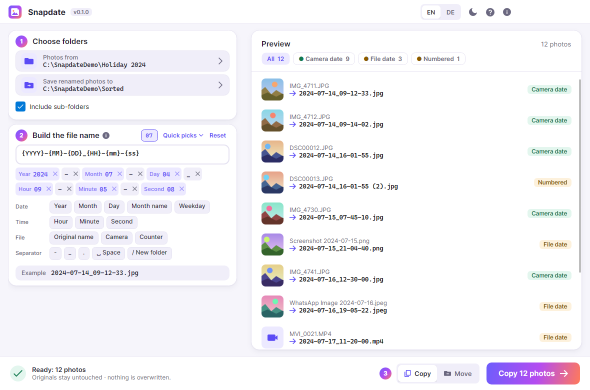
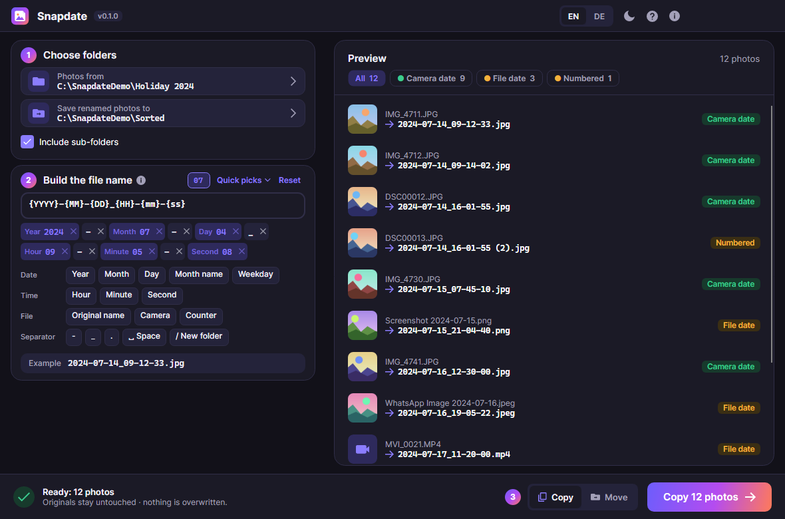
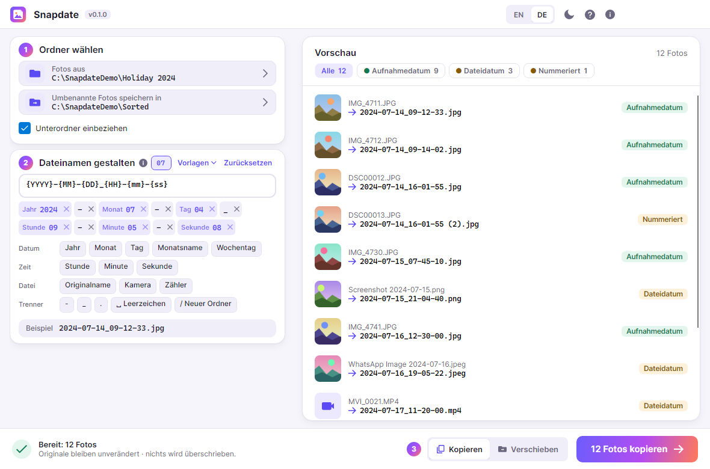

<div align="center">


# Snapdate

**Sort your photos by the day they were taken.**<br>
*Fotos nach Aufnahmedatum sortieren.*

[](https://github.com/jannikjordan/snapdate/releases)


[](https://github.com/jannikjordan/snapdate/actions/workflows/ci.yml)
[](LICENSE)

🇬🇧 [English](#-english) · 🇩🇪 [Deutsch](#-deutsch)



</div>

---

## 🇬🇧 English

Snapdate is a small, friendly Windows app that takes a folder full of photos —
`IMG_4711.JPG`, `DSC00012.JPG`, `WhatsApp Image….jpeg` — and gives every file a
clean, sortable name based on **when the photo was taken**, for example
`2024-07-14_09-12-33.jpg`.

**Download one file, double-click, done.** Nothing to install.

### ✨ Features

- 📁 **Two folders, that's it** — where your photos are, and where the renamed ones go. Drag & drop works too.
- 🕒 **The real capture date** — read from inside the photo (EXIF, XMP, video and PNG data). No date inside? The file date is used and clearly marked.
- 🧩 **Build your own name with blocks** — Year, Month, Day, Hour, Original name, Camera, Counter … with or without leading zeros (`07` or `7`), plus any text you like: `Holiday {D}.{M}.{YYYY} {HH}{mm}`.
- 🗂️ **Folders by year and month** — `2024\07\2024-07-14 IMG_4711.jpg` with one click.
- 👀 **Preview first** — every old → new name with thumbnail before anything happens.
- 🛡️ **Safe by default** — copies instead of moving, **never overwrites**, adds `(2)` for duplicates, verifies every copy and writes a log.
- 🖼️ **Many formats** — JPG, PNG, HEIC, AVIF, WebP, TIFF, GIF, BMP, camera RAW (DNG, CR3, NEF, ARW …) and videos (MP4, MOV). The file type is always kept.
- 🌍 **English & Deutsch** — chosen from your Windows language, switchable any time.
- 🌗 **Light & dark** — follows Windows.
- 🔒 **Private** — fully offline. No account, no tracking.

### ⬇️ Download

Get **`Snapdate-vX.Y.Z-win-x64.exe`** from the
[latest release](https://github.com/jannikjordan/snapdate/releases/latest)
(ARM PCs: `win-arm64`). Windows may say *“Windows protected your PC”* on first
start — click **More info → Run anyway**.

### 🚀 How it works


| | |
|---|---|
|  |  |
| **Your own text** between the blocks | **Year / month folders** with one block |
|  |  |
| **Asks before moving** originals | **Dark mode** included |

📖 **Full guide with pictures: [User guide (English)](docs/user-guide.en.md)**

---

## 🇩🇪 Deutsch

Snapdate ist eine kleine, freundliche Windows-App: Sie nimmt einen Ordner voller
Fotos — `IMG_4711.JPG`, `DSC00012.JPG`, `WhatsApp Image….jpeg` — und gibt jeder
Datei einen klaren, sortierbaren Namen nach dem **Aufnahmezeitpunkt**, zum
Beispiel `2024-07-14_09-12-33.jpg`.

**Eine Datei herunterladen, doppelklicken, fertig.** Keine Installation.

### ✨ Funktionen

- 📁 **Nur zwei Ordner** — wo Ihre Fotos sind und wohin die umbenannten sollen. Ziehen & Ablegen funktioniert auch.
- 🕒 **Das echte Aufnahmedatum** — direkt aus dem Foto gelesen (EXIF, XMP, Video- und PNG-Daten). Kein Datum enthalten? Dann wird das Dateidatum verwendet und deutlich markiert.
- 🧩 **Namen aus Bausteinen** — Jahr, Monat, Tag, Stunde, Originalname, Kamera, Zähler … mit oder ohne führende Null (`07` oder `7`) und mit beliebigem eigenem Text: `Urlaub {D}.{M}.{YYYY} {HH}{mm}`.
- 🗂️ **Ordner nach Jahr und Monat** — `2024\07\2024-07-14 IMG_4711.jpg` mit einem Klick.
- 👀 **Erst die Vorschau** — jeder alte → neue Name mit Miniaturbild, bevor etwas passiert.
- 🛡️ **Sicher von Anfang an** — kopiert statt verschiebt, **überschreibt nie**, ergänzt `(2)` bei Doppelten, prüft jede Kopie und schreibt ein Protokoll.
- 🖼️ **Viele Formate** — JPG, PNG, HEIC, AVIF, WebP, TIFF, GIF, BMP, Kamera-RAW (DNG, CR3, NEF, ARW …) und Videos (MP4, MOV). Der Dateityp bleibt immer erhalten.
- 🌍 **Deutsch & English** — passend zur Windows-Sprache, jederzeit umschaltbar.
- 🌗 **Hell & dunkel** — folgt Windows.
- 🔒 **Privat** — komplett offline. Kein Konto, kein Tracking.

### ⬇️ Herunterladen

Laden Sie **`Snapdate-vX.Y.Z-win-x64.exe`** aus dem
[neuesten Release](https://github.com/jannikjordan/snapdate/releases/latest)
(ARM-PCs: `win-arm64`). Beim ersten Start meldet Windows eventuell *„Der
Computer wurde durch Windows geschützt“* — klicken Sie auf
**Weitere Informationen → Trotzdem ausführen**.

| | |
|---|---|
|  |  |
| **Vorschau** mit Herkunft des Datums | **Fertig** — Ordner direkt öffnen |

📖 **Ausführliche Anleitung mit Bildern: [Anleitung (Deutsch)](docs/user-guide.de.md)**

---

## 🛠️ For developers

Built with **.NET 10 (LTS)**, **Avalonia 12** and **MetadataExtractor**,
shipped as one **self-contained, trimmed executable** for `win-x64` and `win-arm64`.

```bash
pwsh scripts/build/build.ps1 -Target Test
```

```bash
dotnet run --project src/Snapdate.App
```

| Topic | Document |
|---|---|
| Architecture | [docs/architecture.md](docs/architecture.md) |
| Design system | [DESIGN.md](DESIGN.md) |
| Security | [docs/security.md](docs/security.md) · [SECURITY.md](SECURITY.md) |
| Build & release | [docs/build-and-release.md](docs/build-and-release.md) |
| Contributing / agents | [AGENTS.md](AGENTS.md) |
| Plan & decisions | [docs/PLAN.md](docs/PLAN.md) · [docs/adr](docs/adr) |
| Changes | [CHANGELOG.md](CHANGELOG.md) |

## 📄 License

[MIT](LICENSE) © Snapdate contributors
