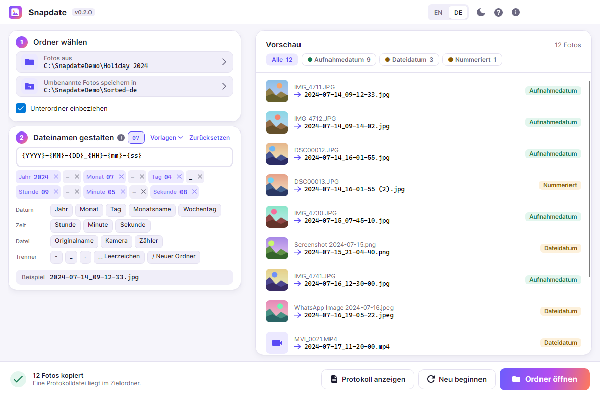

<div align="center">


# Snapdate

**Sort your photos by the day they were taken.**<br>
*Fotos nach Aufnahmedatum sortieren.*

[](https://github.com/jannikjordan/snapdate/releases)


[](https://github.com/jannikjordan/snapdate/actions/workflows/ci.yml)
[](LICENSE)

🇬🇧 [English](#-english) · 🇩🇪 [Deutsch](#-deutsch)


</div>

---

## 🇬🇧 English

Snapdate is a small, friendly Windows app that takes a folder full of photos —
`IMG_4711.JPG`, `DSC00012.JPG`, `WhatsApp Image….jpeg` — and gives every file a
clean, sortable name based on **when the photo was taken**, for example
`2024-07-14_09-12-33.jpg`.

**Download one file, double-click, done.** Use the installer — or the portable file if you'd rather not install anything.

### ✨ Features

- 📁 **Two folders, that's it** — where your photos are, and where the renamed ones go. Drag & drop works too.
- 🕒 **The real capture date** — read from inside the photo (EXIF, XMP, video and PNG data). No date inside? Snapdate reads it from the file name (WhatsApp built in, your own rules too), otherwise uses the file date — always clearly marked.
- 🧩 **Build your own name with blocks** — Year, Month, Day, Hour, Original name, Camera, Counter … with or without leading zeros (`07` or `7`), plus any text you like: `Holiday {D}.{M}.{YYYY} {HH}{mm}`.
- 🗂️ **Folders by year and month** — `2024\07\2024-07-14 IMG_4711.jpg` with one click.
- 👀 **Preview first** — every old → new name with thumbnail before anything happens.
- 🛡️ **Safe by default** — copies instead of moving, **never overwrites**, adds `(2)` for duplicates, verifies every copy and writes a log.
- 🖼️ **Many formats** — JPG, PNG, HEIC, AVIF, WebP, TIFF, GIF, BMP, camera RAW (DNG, CR3, NEF, ARW …) and videos (MP4, MOV). The file type is always kept.
- 🌍 **English & Deutsch** — chosen from your Windows language, switchable any time.
- 🌗 **Light & dark** — follows Windows.
- 🔒 **Private** — works offline, except the optional update check, which only asks GitHub for the newest version number. No account, no tracking.
- 🔔 **Tells you about updates** — a slim banner when a new version is out; installed copies update with one click. Can be switched off in *About*.

### ⬇️ Download

Get your file from the [latest release](https://github.com/jannikjordan/snapdate/releases/latest):

| Your PC | **Installer (recommended)** | Portable (no installation) |
|---|---|---|
| Most Windows PCs (Intel / AMD) | `Snapdate-Setup-vX.Y.Z-win-x64.exe` | `Snapdate-vX.Y.Z-win-x64-portable.exe` |
| ARM PCs (Surface Pro X, Copilot+ PCs) | `Snapdate-Setup-vX.Y.Z-win-arm64.exe` | `Snapdate-vX.Y.Z-win-arm64-portable.exe` |

- **Installer** — adds Snapdate to the Start menu (and, if you like, the desktop), for you only or for all users. It also lets Snapdate update itself.
- **Portable** — a single exe: double-click, nothing is installed. It doesn't update itself; when a new version is out it shows a link to download it again.

Windows may say *“Windows protected your PC”* (SmartScreen) the first time,
because Snapdate is new and not yet signed with a paid certificate. That is
expected — click **More info → Run anyway**.

**Privacy:** Snapdate works offline — except the optional update check, which
only asks GitHub (`api.github.com`) for the newest version number. It sends no
photos, file names or personal data (GitHub sees your IP address, like on any
website visit). You can switch it off in *About*.

**Verify your download (optional):** every release lists checksums in
`SHA256SUMS.txt` — compare with `Get-FileHash <file> -Algorithm SHA256` in
PowerShell. The `.sig` files next to each download are for Snapdate's own
updater; you don't need them. Once the repository is public, build provenance
can be checked with `gh attestation verify <file> --repo jannikjordan/snapdate`.
More details: [Install, updates and uninstall](docs/user-guide.en.md#-11-install).

### 🚀 How it works


| | |
|---|---|
|  |  |
| **Your own text** between the blocks | **Year / month folders** with one block |
|  |  |
| **Asks before moving** originals | **Dark mode** included |

📖 **Full guide with pictures: [User guide (English)](docs/user-guide.en.md)**

---

## 🇩🇪 Deutsch

Snapdate ist eine kleine, freundliche Windows-App: Sie nimmt einen Ordner voller
Fotos — `IMG_4711.JPG`, `DSC00012.JPG`, `WhatsApp Image….jpeg` — und gibt jeder
Datei einen klaren, sortierbaren Namen nach dem **Aufnahmezeitpunkt**, zum
Beispiel `2024-07-14_09-12-33.jpg`.

**Eine Datei herunterladen, doppelklicken, fertig.** Mit Installer — oder als portable Datei, wenn Sie nichts installieren möchten.

### ✨ Funktionen

- 📁 **Nur zwei Ordner** — wo Ihre Fotos sind und wohin die umbenannten sollen. Ziehen & Ablegen funktioniert auch.
- 🕒 **Das echte Aufnahmedatum** — direkt aus dem Foto gelesen (EXIF, XMP, Video- und PNG-Daten). Kein Datum enthalten? Dann liest Snapdate es aus dem Dateinamen (WhatsApp eingebaut, eigene Regeln möglich), sonst gilt das Dateidatum — immer deutlich markiert.
- 🧩 **Namen aus Bausteinen** — Jahr, Monat, Tag, Stunde, Originalname, Kamera, Zähler … mit oder ohne führende Null (`07` oder `7`) und mit beliebigem eigenem Text: `Urlaub {D}.{M}.{YYYY} {HH}{mm}`.
- 🗂️ **Ordner nach Jahr und Monat** — `2024\07\2024-07-14 IMG_4711.jpg` mit einem Klick.
- 👀 **Erst die Vorschau** — jeder alte → neue Name mit Miniaturbild, bevor etwas passiert.
- 🛡️ **Sicher von Anfang an** — kopiert statt verschiebt, **überschreibt nie**, ergänzt `(2)` bei Doppelten, prüft jede Kopie und schreibt ein Protokoll.
- 🖼️ **Viele Formate** — JPG, PNG, HEIC, AVIF, WebP, TIFF, GIF, BMP, Kamera-RAW (DNG, CR3, NEF, ARW …) und Videos (MP4, MOV). Der Dateityp bleibt immer erhalten.
- 🌍 **Deutsch & English** — passend zur Windows-Sprache, jederzeit umschaltbar.
- 🌗 **Hell & dunkel** — folgt Windows.
- 🔒 **Privat** — arbeitet offline, bis auf die optionale Update-Prüfung, die bei GitHub nur nach der neuesten Versionsnummer fragt. Kein Konto, kein Tracking.
- 🔔 **Meldet Updates** — ein schmaler Hinweis, wenn eine neue Version erschienen ist; installierte Kopien aktualisieren sich mit einem Klick. Unter *Über Snapdate* abschaltbar.

### ⬇️ Herunterladen

Laden Sie Ihre Datei aus dem [neuesten Release](https://github.com/jannikjordan/snapdate/releases/latest) herunter:

| Ihr PC | **Installer (empfohlen)** | Portabel (ohne Installation) |
|---|---|---|
| Die meisten Windows-PCs (Intel / AMD) | `Snapdate-Setup-vX.Y.Z-win-x64.exe` | `Snapdate-vX.Y.Z-win-x64-portable.exe` |
| ARM-PCs (Surface Pro X, Copilot+ PCs) | `Snapdate-Setup-vX.Y.Z-win-arm64.exe` | `Snapdate-vX.Y.Z-win-arm64-portable.exe` |

- **Installer** — legt Snapdate im Startmenü an (auf Wunsch auch auf dem Desktop), nur für Sie oder für alle Benutzer. Damit kann sich Snapdate auch selbst aktualisieren.
- **Portabel** — eine einzelne exe: doppelklicken, nichts wird installiert. Sie aktualisiert sich nicht selbst; gibt es eine neue Version, zeigt sie einen Link zum erneuten Herunterladen.

Beim ersten Start meldet Windows eventuell *„Der Computer wurde durch Windows
geschützt“* (SmartScreen), weil Snapdate neu und noch nicht mit einem
kostenpflichtigen Zertifikat signiert ist. Das ist zu erwarten — klicken Sie auf
**Weitere Informationen → Trotzdem ausführen**.

**Datenschutz:** Snapdate arbeitet offline — bis auf die optionale
Update-Prüfung, die bei GitHub (`api.github.com`) nur nach der neuesten
Versionsnummer fragt. Es werden keine Fotos, Dateinamen oder persönlichen Daten
gesendet (GitHub sieht Ihre IP-Adresse, wie bei jedem Webseitenbesuch). Sie
können die Prüfung unter *Über Snapdate* ausschalten.

**Download prüfen (optional):** Jedes Release enthält Prüfsummen in
`SHA256SUMS.txt` — vergleichen Sie mit `Get-FileHash <Datei> -Algorithm SHA256`
in PowerShell. Die `.sig`-Dateien neben jedem Download sind für die
Aktualisierung in Snapdate selbst bestimmt; Sie brauchen sie nicht. Sobald das
Repository öffentlich ist, lässt sich die Herkunft mit
`gh attestation verify <Datei> --repo jannikjordan/snapdate` prüfen.
Mehr dazu: [Installation, Updates und Deinstallation](docs/user-guide.de.md#-11-installation).

| | |
|---|---|
|  |  |
| **Vorschau** mit Herkunft des Datums | **Fertig** — Ordner direkt öffnen |

📖 **Ausführliche Anleitung mit Bildern: [Anleitung (Deutsch)](docs/user-guide.de.md)**

---

## 🛠️ For developers

Built with **.NET 10 (LTS)**, **Avalonia 12** and **MetadataExtractor**,
shipped as one **self-contained, trimmed executable** for `win-x64` and `win-arm64`.

```bash
pwsh scripts/build/build.ps1 -Target Test
```

```bash
dotnet run --project src/Snapdate.App
```

| Topic | Document |
|---|---|
| Architecture | [docs/architecture.md](docs/architecture.md) |
| Design system | [DESIGN.md](DESIGN.md) |
| Security | [docs/security.md](docs/security.md) · [SECURITY.md](SECURITY.md) |
| Build & release | [docs/build-and-release.md](docs/build-and-release.md) |
| Contributing / agents | [AGENTS.md](AGENTS.md) |
| Plan & decisions | [docs/PLAN.md](docs/PLAN.md) · [docs/adr](docs/adr) |
| Changes | [CHANGELOG.md](CHANGELOG.md) |

## 📄 License

[MIT](LICENSE) © Snapdate contributors
