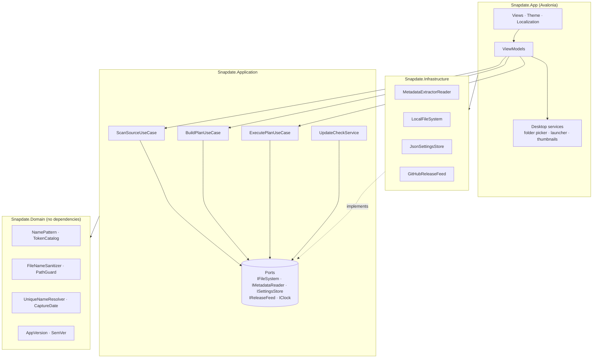
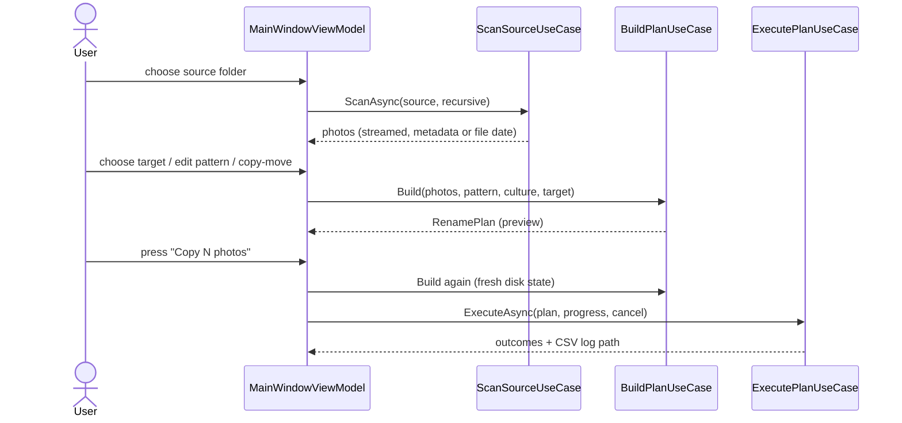

# 🏗️ Architecture

Snapdate follows a small **clean / hexagonal architecture**: the domain knows
nothing about files, metadata libraries or the UI, so the important rules
(naming, sanitising, never overwriting) are pure and fully unit-tested.

The dependency rules are enforced by `tests/Snapdate.Architecture.Tests`.

## Projects

| Project | Responsibility |
|---|---|
| `Snapdate.Domain` | Pattern parsing/rendering, placeholder catalogue, sanitising, path guard, duplicate-free names, `AppVersion` (SemVer). No package references. |
| `Snapdate.Application` | Use cases (scan → plan → execute, update check), ports, folder checks, settings model, UI language rules. |
| `Snapdate.Infrastructure` | MetadataExtractor adapter, safe local file system, JSON settings store, GitHub release feed (the only network code). |
| `Snapdate.App` | Avalonia UI: MVVM with CommunityToolkit source generators, compiled bindings, design tokens, EN/DE resources, composition root in `App.axaml.cs`. |
| `tools/Snapdate.AssetGen` | Developer tool: renders `app.ico` and the documentation screenshots headlessly from the real views. |

## The run, step by step

## Key decisions

- [ADR 0001 — Avalonia for the user interface](adr/0001-avalonia-ui.md)
- [ADR 0002 — Native AOT releases and locked package restore](adr/0002-native-aot-and-locked-restore.md) (AOT part superseded)
- [ADR 0003 — Self-contained single-file exe instead of Native AOT](adr/0003-single-file-instead-of-native-aot.md)

## Conventions

- AOT/trim safe only: no reflection-based serialisation or DI, compiled XAML
  bindings, source-generated JSON and MVVM.
- UI text lives in `src/Snapdate.App/Localization/strings.tsv`; run
  `pwsh scripts/dev/Update-Strings.ps1` to regenerate the `.resx` files and the
  typed accessor.
- Colours, radii and fonts come from `Theme/Tokens.axaml` (see [DESIGN.md](../DESIGN.md)).
