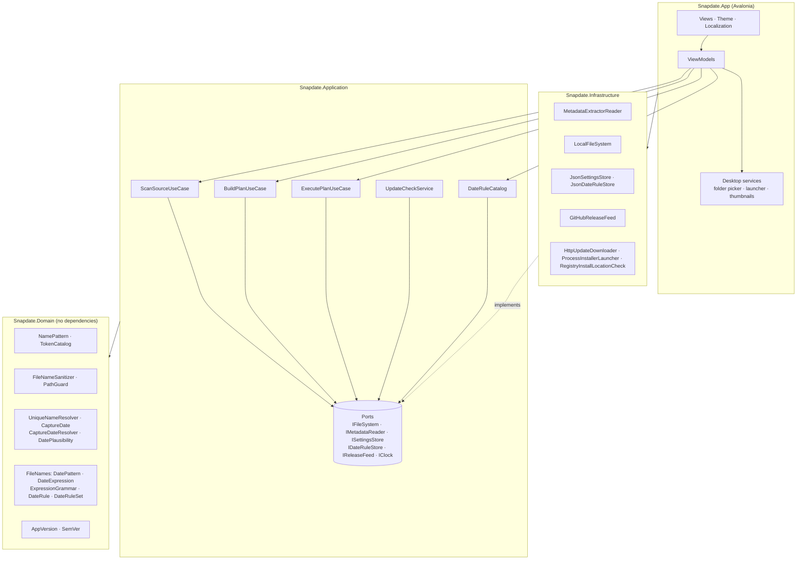
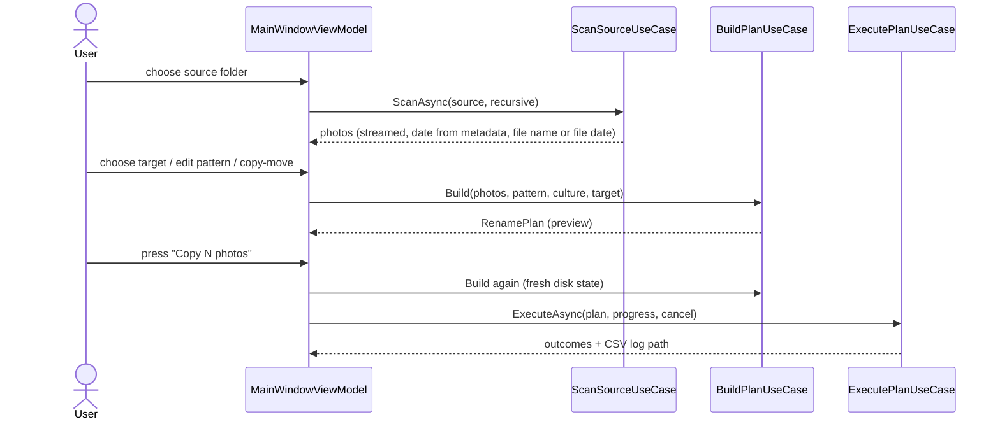

# 🏗️ Architecture

Snapdate follows a small **clean / hexagonal architecture**: the domain knows
nothing about files, metadata libraries or the UI, so the important rules
(naming, sanitising, never overwriting) are pure and fully unit-tested.



The dependency rules are enforced by `tests/Snapdate.Architecture.Tests`.

## Projects

| Project | Responsibility |
|---|---|
| `Snapdate.Domain` | Pattern parsing/rendering, placeholder catalogue, sanitising, path guard, duplicate-free names, capture-date resolution and plausibility, file-name date rules (token patterns, checked regular expressions, rule set), `AppVersion` (SemVer). No package references. |
| `Snapdate.Application` | Use cases (scan → plan → execute, update check), ports, folder checks, settings model, file-name date rule catalogue (`DateRuleCatalog`, `IDateRuleStore`), UI language rules, install info (`IInstallInfo`). |
| `Snapdate.Infrastructure` | MetadataExtractor adapter, safe local file system, JSON settings store, date rule store (embedded built-in rules, user rules file), GitHub release feed (the only network code), install-marker reader. |
| `Snapdate.App` | Avalonia UI: MVVM with CommunityToolkit source generators, compiled bindings, design tokens, EN/DE resources, composition root in `App.axaml.cs`. |
| `tools/Snapdate.AssetGen` | Developer tool: renders `app.ico` and the documentation screenshots headlessly from the real views. |

## The run, step by step



## Capture date resolution

Decision and details: [ADR 0007](adr/0007-dates-from-file-names.md).

- **Rules (Domain, `FileNames/`).** A `DateRule` has 1–10 lines, either token
  patterns (`DatePattern`, e.g. `IMG-{YYYY}{MM}{DD}-WA*`) or, in the advanced
  mode, regular expressions (`DateExpression`). Token patterns are compiled to
  a regex by Snapdate; regular expressions are first checked by
  `ExpressionGrammar`, Snapdate's own parser for the allowed subset (width
  rule, quantifier budget), and then compiled. Everything runs with
  `NonBacktracking` and a 50 ms timeout; validation problems are values, never
  exceptions. `DateRuleSet.Match` tries the rules in order (enabled custom rules,
  then enabled system rules), returns the first valid and plausible date
  (`DatePlausibility`), and stops trying regex rules for a name after 200 ms
  together.
- **Catalogue (Application).** `DateRuleCatalog` loads the built-in rules and
  the user's rules through the port `IDateRuleStore`, builds the effective
  `DateRuleSet` and handles switch on/off, duplicate, add, edit and delete.
  Each save passes the `UserRulesFingerprint` (length + SHA-256) of the file it
  was loaded from; the store refuses to write when the file changed meanwhile
  (`Conflict`), so a second app instance never overwrites newer rules. When
  the user file is `Inaccessible` (could not be opened) or was written by a
  newer version (`NewerVersion`), the catalogue is read-only.
- **Store (Infrastructure).** `JsonDateRuleStore` reads the built-in rules from
  JSON embedded in the assembly and the user's rules from
  `%APPDATA%\Snapdate\date-rules.json` (source-generated `System.Text.Json`,
  64 KB cap, temp file + atomic move; an unreadable file is moved aside, never
  overwritten).
- **Scan (Application → Domain).** `ScanSourceUseCase` receives the effective
  `DateRuleSet`, reads the metadata (with "has a camera model") and matches the
  file name, then `CaptureDateResolver.Resolve` picks the date: camera metadata
  → file-name date → app-written metadata → file timestamp. Same-day metadata
  is kept; a different day sets the "Dates differ" flag with the date that was
  not used. A date-only name takes the file timestamp's time when it is on the
  same day, else 00:00:00. The file timestamp is read only when needed.
- **App.** The preview shows the source as a badge/filter (`DateSource.FileName`
  = "Date from name") and the "Dates differ" hint; the rules dialog and editor
  work on the catalogue, and the scan is repeated with the new rule set when the
  dialog closes after a change.

## Installed or portable

The Inno Setup installer (`installer/Snapdate.iss`) writes a marker file
`snapdate-install.ini` next to `Snapdate.exe`:

```ini
[Install]
Scope=user
```

`Scope` is `user` (per-user install) or `all` (all users). The port
`IInstallInfo.Current` returns an `InstallInfo(Kind, Scope)` with
`InstallKind.Installed` or `InstallKind.Portable` and `InstallScope.CurrentUser`,
`AllUsers` or `None`. `FileInstallInfo` (Infrastructure) reads the marker next to
`Environment.ProcessPath` once, strictly: a missing, oversized, non-UTF-8 or
malformed file (wrong section, unknown or duplicate `Scope`, stray lines) means
portable, and it never throws. The marker is a hint for the UI (for example
which update path to offer), not a security boundary; downloaded updates are
signature-verified regardless.

## In-app update (core)

`InstallUpdateUseCase` (Application, no UI) turns a `ReleaseInfo` into a started installer:
`IsApplicable` (Installed marker, confirmed by `IInstallLocationCheck` against the uninstall registry key; newer stable
release; supported `IProcessArchitecture`) → pick `Snapdate-Setup-v<ver>-win-<arch>.exe` and its `.sig` →
`IUpdateDownloader.DownloadAsync` (progress as `UpdateProgress`) → `IUpdateSignatureVerifier.Verify` on the held
`IDownloadedFile.Content` → `IInstallerLauncher.Launch(path, scope)`. The result is an `UpdateInstallResult`
(`Completed`, `InstallerRunning`, `NotApplicable`, `AssetMissing`, `DownloadFailed`, `VerificationFailed`,
`LaunchFailed`, `InstallerFailed`, `Cancelled`). After starting the installer the use case waits for its exit (or the
app's shutdown token) while holding the verified file; the app must not exit by itself meanwhile. No
exceptions reach the UI. Adapters live in Infrastructure (`HttpUpdateDownloader`, `ProcessInstallerLauncher`,
`RegistryInstallLocationCheck`, `ProcessArchitecture`). Rules and threat model: [security.md](security.md),
[ADR 0004](adr/0004-update-check-and-in-app-update.md).

## Key decisions

- [ADR 0001 — Avalonia for the user interface](adr/0001-avalonia-ui.md)
- [ADR 0002 — Native AOT releases and locked package restore](adr/0002-native-aot-and-locked-restore.md) (AOT part superseded)
- [ADR 0003 — Self-contained single-file exe instead of Native AOT](adr/0003-single-file-instead-of-native-aot.md)
- [ADR 0006 — Inno Setup installer](adr/0006-inno-setup-installer.md)
- [ADR 0007 — Dates from file names](adr/0007-dates-from-file-names.md)

## Conventions

- AOT/trim safe only: no reflection-based serialisation or DI, compiled XAML
  bindings, source-generated JSON and MVVM.
- UI text lives in `src/Snapdate.App/Localization/strings.tsv`; run
  `pwsh scripts/dev/Update-Strings.ps1` to regenerate the `.resx` files and the
  typed accessor.
- Colours, radii and fonts come from `Theme/Tokens.axaml` (see [DESIGN.md](../DESIGN.md)).
