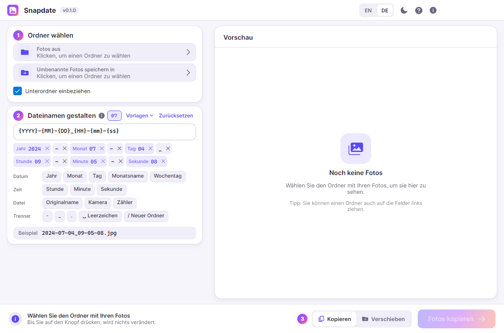
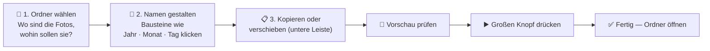
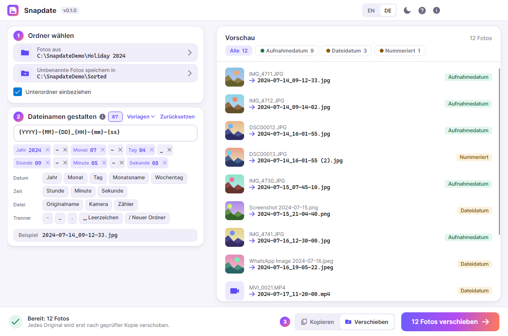
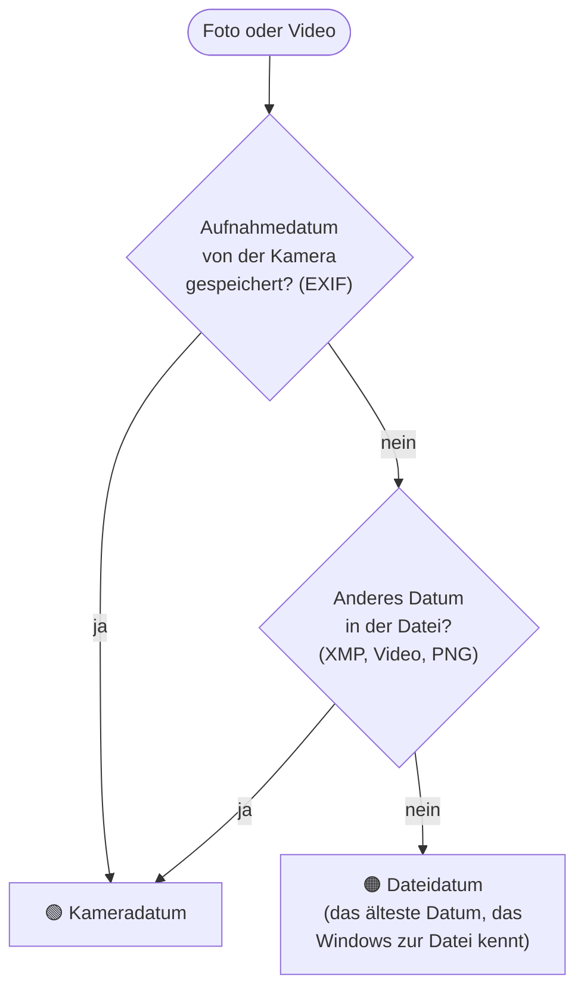

<p align="center"></p>

# 📖 Snapdate — Anleitung

[🇬🇧 English](user-guide.en.md) · 🇩🇪 Deutsch

Snapdate gibt Ihren Fotos **klare Namen nach dem Tag, an dem sie aufgenommen
wurden**. Statt `IMG_4711.JPG`, `DSC00012.JPG` und `WhatsApp Image….jpeg`
heißen sie dann zum Beispiel `2024-07-14_09-12-33.jpg` — und alle Bilder stehen
in der richtigen Reihenfolge, in jedem Ordner, auf jedem Computer.

> 💡 **Sie können nichts kaputt machen.** Snapdate *kopiert* Ihre Fotos
> standardmäßig und **überschreibt niemals** eine Datei. Ihre Originale bleiben,
> wo sie sind.

---

## Inhalt

1. [Los geht's](#-1-los-gehts)
2. [Die drei Schritte im Überblick](#-2-die-drei-schritte-im-überblick)
3. [Schritt 1 — Ordner wählen](#-3-schritt-1--ordner-wählen)
4. [Schritt 2 — Dateinamen gestalten](#-4-schritt-2--dateinamen-gestalten)
5. [Schritt 3 — Kopieren oder verschieben](#-5-schritt-3--kopieren-oder-verschieben)
6. [Vorschau prüfen](#-6-vorschau-prüfen)
7. [Los!](#-7-los)
8. [Woher kommt das Datum?](#-8-woher-kommt-das-datum)
9. [Alle Bausteine (Platzhalter)](#-9-alle-bausteine-platzhalter)
10. [Fragen & Antworten](#-10-fragen--antworten)

---

## 🚀 1. Los geht's

1. Laden Sie `Snapdate-…-win-x64.exe` von der
   [Release-Seite](https://github.com/jannikjordan/snapdate/releases) herunter.
   (Auf ARM-Geräten wie Surface Pro X oder Copilot+ PCs: `win-arm64`.)
2. Doppelklick auf die Datei. Es muss **nichts installiert** werden.
3. Beim ersten Start zeigt Windows eventuell *„Der Computer wurde durch Windows
   geschützt“*, weil die App neu ist. Klicken Sie auf
   **Weitere Informationen → Trotzdem ausführen**.

Snapdate spricht **Deutsch und Englisch**. Die Sprache Ihres Windows wird
automatisch gewählt — umschalten können Sie jederzeit oben rechts mit
**EN | DE**. Der 🌙-Knopf wechselt zwischen hell und dunkel, **?** öffnet diese
Anleitung.



---

## 🧭 2. Die drei Schritte im Überblick



An Ihren Dateien passiert nichts, bevor Sie den großen Knopf unten rechts
drücken. Bis dahin ist alles nur eine Vorschau.

---

## 📁 3. Schritt 1 — Ordner wählen

| Feld | Was Sie wählen |
|---|---|
| **Fotos aus** | Der Ordner mit Ihren Bildern, z. B. die Handy-Sicherung oder die SD-Karte. |
| **Umbenannte Fotos speichern in** | Wohin die umbenannten Kopien sollen, z. B. ein neuer Ordner *„Fotos sortiert“*. |

Klicken Sie auf ein Feld, um einen Ordner auszuwählen — oder **ziehen Sie
einen Ordner aus dem Explorer einfach auf das Feld**.

**Unterordner einbeziehen** — ist das Häkchen gesetzt, schaut Snapdate auch in
alle Ordner innerhalb Ihres Fotoordners. Praktisch bei Handy-Sicherungen wie
`DCIM\100APPLE`, `DCIM\101APPLE` …

> ⚠️ Der Zielordner darf nicht *im* Fotoordner liegen, solange
> „Unterordner einbeziehen“ aktiv ist — sonst würde Snapdate beim nächsten Mal
> seine eigenen Kopien finden. Snapdate weist Sie darauf hin.


---

## 🧩 4. Schritt 2 — Dateinamen gestalten

Hier legen Sie fest, wie die neuen Namen aussehen. Sie müssen nichts
Besonderes eintippen — **klicken Sie einfach auf die Bausteine**:

| Gruppe | Bausteine |
|---|---|
| **Datum** | Jahr · Monat · Tag · Monatsname · Wochentag |
| **Zeit** | Stunde · Minute · Sekunde |
| **Datei** | Originalname · Kamera · Zähler |
| **Trenner** | `-` · `_` · `.` · Leerzeichen · Neuer Ordner (`/`) |

Jeder Klick fügt den Baustein dort ein, wo Ihr Cursor im Feld darüber steht.
Die farbige Reihe unter dem Feld zeigt, was Sie gebaut haben — mit
Beispielwert:

- **Klick auf einen Baustein** wechselt seine Form: `07 ⇄ 7`, `2024 ⇄ 24`,
  `Jul ⇄ Juli`, `So ⇄ Sonntag`.
- **Klick auf das ✕** daneben entfernt ihn.
- Der kleine Knopf **07** neben der Überschrift stellt alle Datums- und Zeitbausteine auf einmal zwischen `07` und `7` um.

### ✍️ Eigener Text

Sie können **beliebigen Text** in das Feld tippen, überall zwischen die
Bausteine — zum Beispiel `Urlaub ` vor das Datum:

```
Urlaub {D}.{M}.{YYYY} {HH}{mm}   →   Urlaub 14.7.2024 0912.jpg
```


### 🗂️ In Ordner sortieren

Der Baustein **Neuer Ordner** (`/`) legt Fotos in Unterordner. Zum Beispiel ein
Ordner pro Jahr und Monat:

```
{YYYY}/{MM}/{YYYY}-{MM}-{DD} {name}   →   2024\07\2024-07-14 IMG_4711.jpg
```


### ⚡ Vorlagen

Keine Lust zu basteln? Öffnen Sie **Vorlagen ▾** neben der Überschrift — die Einträge zeigen
genau, wie das Ergebnis aussieht. **Zurücksetzen** stellt den Standardnamen
wieder her.

> 💡 Der Dateityp (`.jpg`, `.png`, `.heic` …) **bleibt immer automatisch
> erhalten**. Sie müssen ihn nie hinzufügen.

Wenn etwas im Feld nicht funktionieren kann (zum Beispiel ein Zeichen, das
Windows in Dateinamen nicht erlaubt, wie `:` oder `?`), wird das Feld rot und
erklärt in einfachen Worten, was zu tun ist:


---

## 📋 5. Schritt 3 — Kopieren oder verschieben

Diese Wahl finden Sie in der **Leiste unten**, direkt neben dem großen Knopf:
**Kopieren** oder **Verschieben**.



| Option | Was passiert | Wann sinnvoll |
|---|---|---|
| **Kopieren** *(empfohlen)* | Originale bleiben unverändert; es entstehen umbenannte Kopien. | Fast immer. Die sicherste Wahl. |
| **Verschieben** | Die Fotos wandern mit neuem Namen in den Zielordner. | Zum Aufräumen, wenn Sie eine Sicherung haben. |

Beim Verschieben erstellt Snapdate zuerst eine **geprüfte Kopie** und entfernt
erst danach das Original. Auf demselben Laufwerk wird einfach umbenannt —
sofort und sicher. Vor dem Verschieben fragt Snapdate noch einmal nach:


---

## 👀 6. Vorschau prüfen

Rechts sehen Sie jedes Foto: ein kleines Bild, den **alten Namen** in grau und
den **neuen Namen** fett. Ein farbiges Etikett zeigt, woher das Datum stammt:

| Etikett | Bedeutung |
|---|---|
| 🟢 **Aufnahmedatum** | Das Datum stammt aus dem Foto selbst — der Moment der Aufnahme. |
| 🟠 **Dateidatum** | Die Datei enthält kein Datum (typisch für Screenshots und Chat-Bilder), daher wurde das Datum der Datei verwendet. |
| 🟠 **Nummeriert** | Zwei Fotos bekämen denselben Namen (z. B. in derselben Sekunde aufgenommen), daher wurde `(2)`, `(3)` … ergänzt. |

Mit den Reitern **Alle · Aufnahmedatum · Dateidatum · Nummeriert** sehen Sie
nur eine Gruppe.

---

## ▶️ 7. Los!

Wenn alles passt, drücken Sie unten rechts **12 Fotos kopieren** (oder
**… verschieben**). Ein Fortschrittsbalken zeigt den Stand; mit **Abbrechen**
können Sie jederzeit stoppen — noch nicht bearbeitete Dateien bleiben
unverändert.

Danach können Sie den **Ordner direkt öffnen**. Snapdate legt außerdem eine
kleine **Protokolldatei** (`snapdate-log-….csv`) in den Zielordner, mit jedem
alten und neuen Namen — sie lässt sich mit Excel öffnen.


---

## 🔍 8. Woher kommt das Datum?

Snapdate sucht das Datum in dieser Reihenfolge und nimmt das erste, das es
findet:



Daten, die nicht stimmen können — weit in der Zukunft oder vor 1900 — werden
ignoriert.

---

## 🧩 9. Alle Bausteine (Platzhalter)

Im Feld erscheint jeder Baustein als kurzer Code in geschweiften Klammern. Sie
können die Codes auch selbst tippen. **Groß- und Kleinschreibung zählt**: `MM`
ist der Monat, `mm` die Minute.

| Baustein | Code | Beispiel |
|---|---|---|
| Jahr | `{YYYY}` · `{YY}` | `2024` · `24` |
| Monat | `{MM}` · `{M}` | `07` · `7` |
| Monatsname | `{MMM}` · `{MMMM}` | `Jul` · `Juli` |
| Tag | `{DD}` · `{D}` | `04` · `4` |
| Wochentag | `{ddd}` · `{dddd}` | `Do` · `Donnerstag` |
| Stunde (24 h) | `{HH}` · `{H}` | `09` · `9` |
| Minute | `{mm}` · `{m}` | `05` · `5` |
| Sekunde | `{ss}` · `{s}` | `08` · `8` |
| Originalname | `{name}` | `IMG_4711` |
| Kamera | `{camera}` | `iPhone 15 Pro` |
| Zähler | `{counter}` | `001`, `002`, … (in Datumsreihenfolge) |

Alles außerhalb von `{…}` bleibt genau so, wie Sie es tippen. Eine geschweifte
Klammer selbst schreiben Sie doppelt: `{{` oder `}}`.

**Unterstützte Dateien:** JPG, PNG, HEIC/HEIF, AVIF, WebP, TIFF, GIF, BMP,
Kamera-RAW (DNG, CR2, CR3, NEF, ARW, ORF, RW2, RAF, PEF, …) und Videos (MP4,
MOV, M4V, 3GP).

---

## ❓ 10. Fragen & Antworten

**Werden meine Fotos verändert?**
Nein. Mit **Kopieren** werden Originale nie angefasst. Auch die Bilder selbst
werden nicht verändert — nur die Dateinamen der Kopien sind anders.

**Kann Snapdate etwas überschreiben?**
Nein. Gibt es einen Namen im Zielordner schon, ergänzt Snapdate `(2)`, `(3)` …

**Sendet Snapdate etwas ins Internet?**
Nein. Snapdate arbeitet komplett offline — kein Konto, kein Tracking. Nur die
Knöpfe **?** und *Projektseite* öffnen eine Webseite, und zwar nur, wenn Sie
darauf klicken.

**Warum steht bei manchen Fotos „Dateidatum“?**
Screenshots und Bilder aus Chats oder sozialen Netzwerken enthalten oft kein
Datum. Dann ist das Datum der Datei das Beste, was Snapdate finden kann.

**Wozu ist die Protokolldatei?**
Sie listet auf, was von wo nach wo kopiert oder verschoben wurde. Sie können
sie jederzeit löschen.

**Meine Handyfotos liegen in vielen Unterordnern.**
Setzen Sie das Häkchen bei **Unterordner einbeziehen** und wählen Sie den
Hauptordner (z. B. `DCIM`).

**Wo speichert Snapdate seine Einstellungen?**
In `%APPDATA%\Snapdate\settings.json` (zuletzt gewählte Ordner, Ihr
Namensmuster, Sprache). Löschen Sie die Datei, um neu zu beginnen.

---

<sub>Ein Problem gefunden oder eine Idee? Eröffnen Sie ein Issue auf
[GitHub](https://github.com/jannikjordan/snapdate/issues).</sub>
