<p align="center"></p>

# 📖 Snapdate — Anleitung

[🇬🇧 English](user-guide.en.md) · 🇩🇪 Deutsch

Snapdate gibt Ihren Fotos **klare Namen nach dem Tag, an dem sie aufgenommen
wurden**. Statt `IMG_4711.JPG`, `DSC00012.JPG` und `WhatsApp Image….jpeg`
heißen sie dann zum Beispiel `2024-07-14_09-12-33.jpg` — und alle Bilder stehen
in der richtigen Reihenfolge, in jedem Ordner, auf jedem Computer.

> 💡 **Sie können nichts kaputt machen.** Snapdate *kopiert* Ihre Fotos
> standardmäßig und **überschreibt niemals** eine Datei. Ihre Originale bleiben,
> wo sie sind.

---

## Inhalt

1. [Los geht's](#-1-los-gehts)
2. [Die drei Schritte im Überblick](#-2-die-drei-schritte-im-überblick)
3. [Schritt 1 — Ordner wählen](#-3-schritt-1--ordner-wählen)
4. [Schritt 2 — Dateinamen gestalten](#-4-schritt-2--dateinamen-gestalten)
5. [Schritt 3 — Kopieren oder verschieben](#-5-schritt-3--kopieren-oder-verschieben)
6. [Vorschau prüfen](#-6-vorschau-prüfen)
7. [Los!](#-7-los)
8. [Woher kommt das Datum?](#-8-woher-kommt-das-datum)
9. [Datum aus Dateinamen](#-9-datum-aus-dateinamen)
10. [Alle Bausteine (Platzhalter)](#-10-alle-bausteine-platzhalter)
11. [Installation](#-11-installation)
12. [Portable Version](#-12-portable-version)
13. [Updates](#-13-updates)
14. [Deinstallation](#-14-deinstallation)
15. [Fragen & Antworten](#-15-fragen--antworten)

---

## 🚀 1. Los geht's

1. Laden Sie den Installer `Snapdate-Setup-vX.Y.Z-win-x64.exe` von der
   [Download-Seite](https://github.com/jannikjordan/snapdate/releases/latest) herunter.
   (Auf ARM-Geräten wie Surface Pro X oder Copilot+ PCs: `win-arm64`.)
2. Doppelklick darauf und den Schritten folgen — Einzelheiten unter
   [Installation](#-11-installation). Starten Sie **Snapdate** danach über das Startmenü.
3. Beim ersten Start zeigt Windows eventuell *„Der Computer wurde durch Windows
   geschützt“*, weil die App neu ist. Klicken Sie auf
   **Weitere Informationen → Trotzdem ausführen**.

> 💡 Sie möchten nichts installieren? Nehmen Sie stattdessen die **portable**
> Datei (`Snapdate-vX.Y.Z-win-x64-portable.exe`): einfach doppelklicken. Siehe
> [Portable Version](#-12-portable-version).

Snapdate spricht **Deutsch und Englisch**. Die Sprache Ihres Windows wird
automatisch gewählt — umschalten können Sie jederzeit oben rechts mit
**EN | DE**. Der 🌙-Knopf wechselt zwischen hell und dunkel, **?** öffnet diese
Anleitung.


---

## 🧭 2. Die drei Schritte im Überblick

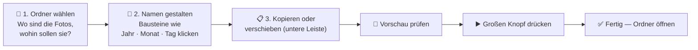

An Ihren Dateien passiert nichts, bevor Sie den großen Knopf unten rechts
drücken. Bis dahin ist alles nur eine Vorschau.

---

## 📁 3. Schritt 1 — Ordner wählen

| Feld | Was Sie wählen |
|---|---|
| **Fotos aus** | Der Ordner mit Ihren Bildern, z. B. die Handy-Sicherung oder die SD-Karte. |
| **Umbenannte Fotos speichern in** | Wohin die umbenannten Kopien sollen, z. B. ein neuer Ordner *„Fotos sortiert“*. |

Klicken Sie auf ein Feld, um einen Ordner auszuwählen — oder **ziehen Sie
einen Ordner aus dem Explorer einfach auf das Feld**.

**Unterordner einbeziehen** — ist das Häkchen gesetzt, schaut Snapdate auch in
alle Ordner innerhalb Ihres Fotoordners. Praktisch bei Handy-Sicherungen wie
`DCIM\100APPLE`, `DCIM\101APPLE` …

> ⚠️ Der Zielordner darf nicht *im* Fotoordner liegen, solange
> „Unterordner einbeziehen“ aktiv ist — sonst würde Snapdate beim nächsten Mal
> seine eigenen Kopien finden. Snapdate weist Sie darauf hin.


---

## 🧩 4. Schritt 2 — Dateinamen gestalten

Hier legen Sie fest, wie die neuen Namen aussehen. Sie müssen nichts
Besonderes eintippen — **klicken Sie einfach auf die Bausteine**:

| Gruppe | Bausteine |
|---|---|
| **Datum** | Jahr · Monat · Tag · Monatsname · Wochentag |
| **Zeit** | Stunde · Minute · Sekunde |
| **Datei** | Originalname · Kamera · Zähler |
| **Trenner** | `-` · `_` · `.` · Leerzeichen · Neuer Ordner (`/`) |

Jeder Klick fügt den Baustein dort ein, wo Ihr Cursor im Feld darüber steht.
Die farbige Reihe unter dem Feld zeigt, was Sie gebaut haben — mit
Beispielwert:

- **Klick auf einen Baustein** wechselt seine Form: `07 ⇄ 7`, `2024 ⇄ 24`,
  `Jul ⇄ Juli`, `So ⇄ Sonntag`.
- **Klick auf das ✕** daneben entfernt ihn.
- Der kleine Knopf **07** neben der Überschrift stellt alle Datums- und Zeitbausteine auf einmal zwischen `07` und `7` um.

### ✍️ Eigener Text

Sie können **beliebigen Text** in das Feld tippen, überall zwischen die
Bausteine — zum Beispiel `Urlaub ` vor das Datum:

```
Urlaub {D}.{M}.{YYYY} {HH}{mm}   →   Urlaub 14.7.2024 0912.jpg
```

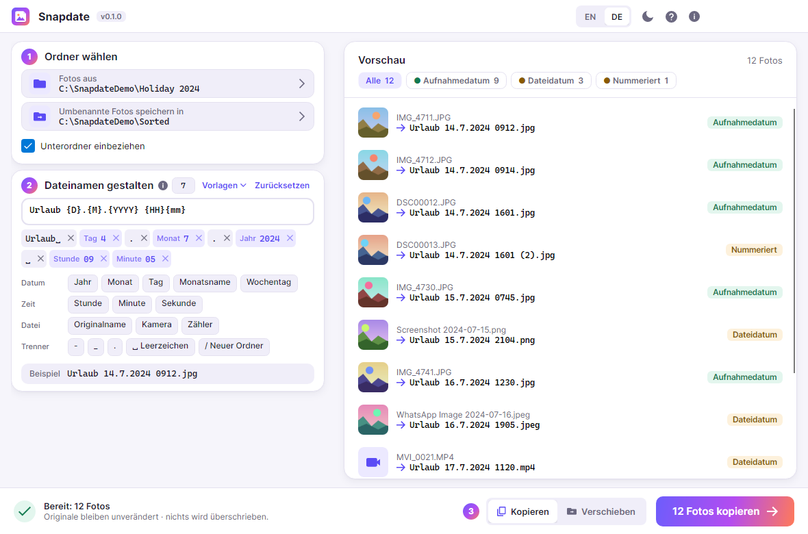

### 🗂️ In Ordner sortieren

Der Baustein **Neuer Ordner** (`/`) legt Fotos in Unterordner. Zum Beispiel ein
Ordner pro Jahr und Monat:

```
{YYYY}/{MM}/{YYYY}-{MM}-{DD} {name}   →   2024\07\2024-07-14 IMG_4711.jpg
```

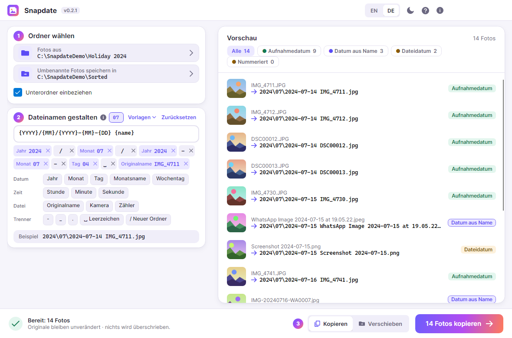

### ⚡ Vorlagen

Keine Lust zu basteln? Öffnen Sie **Vorlagen ▾** neben der Überschrift — die Einträge zeigen
genau, wie das Ergebnis aussieht. **Zurücksetzen** stellt den Standardnamen
wieder her.

> 💡 Der Dateityp (`.jpg`, `.png`, `.heic` …) **bleibt immer automatisch
> erhalten**. Sie müssen ihn nie hinzufügen.

Wenn etwas im Feld nicht funktionieren kann (zum Beispiel ein Zeichen, das
Windows in Dateinamen nicht erlaubt, wie `:` oder `?`), wird das Feld rot und
erklärt in einfachen Worten, was zu tun ist:

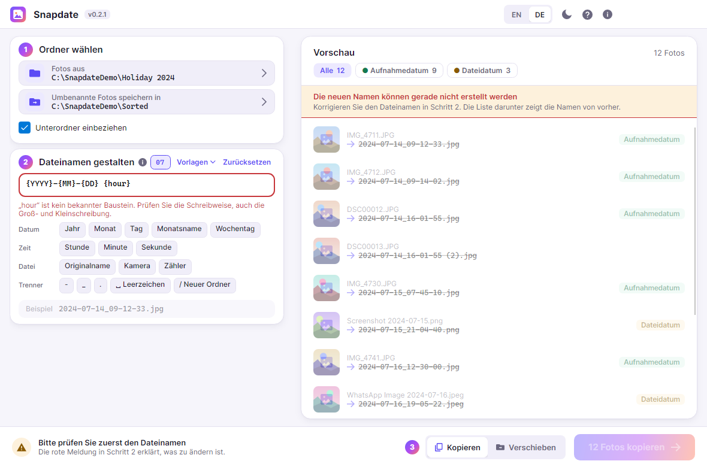

Solange der Dateiname nicht verwendet werden kann, ist die Vorschau rechts
abgeblendet, die neuen Namen sind durchgestrichen und ein roter Hinweis sagt,
dass die Namen gerade nicht erstellt werden können. Die Liste bleibt stehen,
damit Sie nicht den Überblick verlieren. Korrigieren Sie den Dateinamen, und
die Vorschau aktualisiert sich von selbst. Der Knopf **Kopieren** bleibt bis
dahin aus.

---

## 📋 5. Schritt 3 — Kopieren oder verschieben

Diese Wahl finden Sie in der **Leiste unten**, direkt neben dem großen Knopf:
**Kopieren** oder **Verschieben**.


| Option | Was passiert | Wann sinnvoll |
|---|---|---|
| **Kopieren** *(empfohlen)* | Originale bleiben unverändert; es entstehen umbenannte Kopien. | Fast immer. Die sicherste Wahl. |
| **Verschieben** | Die Fotos wandern mit neuem Namen in den Zielordner. | Zum Aufräumen, wenn Sie eine Sicherung haben. |

Beim Verschieben erstellt Snapdate zuerst eine **geprüfte Kopie** und entfernt
erst danach das Original. Auf demselben Laufwerk wird einfach umbenannt —
sofort und sicher. Vor dem Verschieben fragt Snapdate noch einmal nach:


---

## 👀 6. Vorschau prüfen

Rechts sehen Sie jedes Foto: ein kleines Bild, den **alten Namen** in grau und
den **neuen Namen** fett. Ein farbiges Etikett zeigt, woher das Datum stammt:

| Etikett | Bedeutung |
|---|---|
| 🟢 **Aufnahmedatum** | Das Datum stammt aus dem Foto selbst — der Moment der Aufnahme. |
| 🟣 **Datum aus Name** | Das Foto hat kein Aufnahmedatum, aber sein Dateiname enthält eines (z. B. `IMG-20240714-WA0001.jpg` von WhatsApp). Siehe [Datum aus Dateinamen](#-9-datum-aus-dateinamen). |
| 🟠 **Dateidatum** | Die Datei enthält kein Datum und ihr Name auch nicht (typisch für Screenshots und Chat-Bilder), daher wurde das Datum der Datei verwendet. |
| 🟠 **Nummeriert** | Zwei Fotos bekämen denselben Namen (z. B. in derselben Sekunde aufgenommen), daher wurde `(2)`, `(3)` … ergänzt. |

Mit den Reitern **Alle · Aufnahmedatum · Datum aus Name · Dateidatum ·
Nummeriert** sehen Sie nur eine Gruppe.

Ein kleines **⚠ Daten weichen ab** unter dem Etikett bedeutet: Das Foto hatte
zwei Daten an verschiedenen Tagen — zum Beispiel eines im Namen und ein anderes
in der Datei. Zeigen Sie mit der Maus darauf, um zu sehen, welches Datum
verwendet wurde und welches nicht (mehr unter
[Woher kommt das Datum?](#-8-woher-kommt-das-datum)).

---

## ▶️ 7. Los!

Wenn alles passt, drücken Sie unten rechts **12 Fotos kopieren** (oder
**… verschieben**). Ein Fortschrittsbalken zeigt den Stand; mit **Abbrechen**
können Sie jederzeit stoppen — noch nicht bearbeitete Dateien bleiben
unverändert.

Danach können Sie den **Ordner direkt öffnen**. Snapdate legt außerdem eine
kleine **Protokolldatei** (`snapdate-log-….csv`) in den Zielordner, mit jedem
alten und neuen Namen — sie lässt sich mit Excel öffnen.

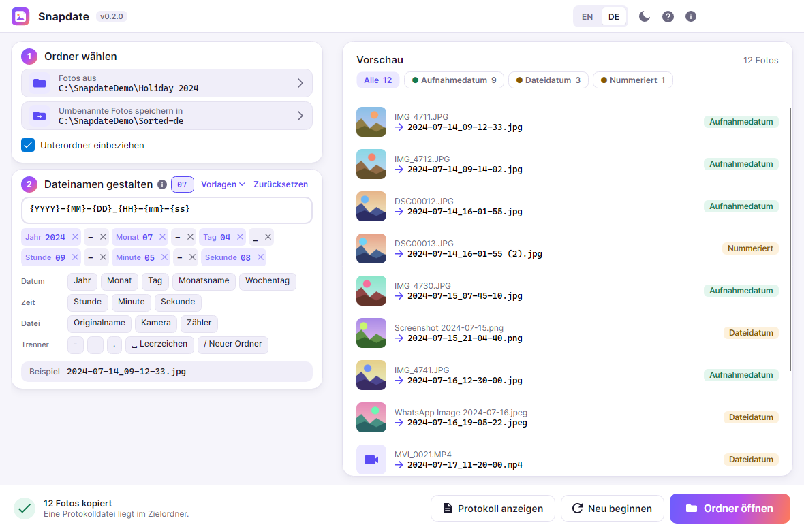

---

## 🔍 8. Woher kommt das Datum?

Snapdate sucht das Datum in dieser Reihenfolge und nimmt das erste, das es
findet:

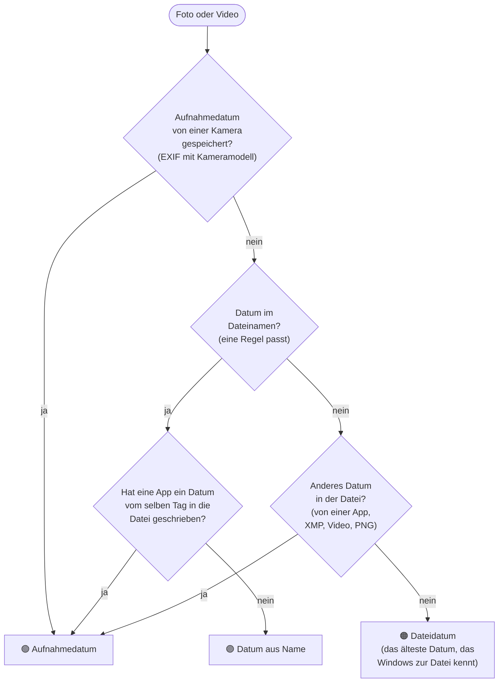

1. **Ein Datum von einer Kamera gewinnt immer.** Nennt der Dateiname einen
   anderen Tag, wird das Foto mit **⚠ Daten weichen ab** markiert, und der
   Hinweis zeigt das nicht verwendete Datum aus dem Namen.
2. **Sonst gewinnt das Datum im Dateinamen** gegen ein Datum, das eine App
   (Galerie-, Backup- oder Chat-App — keine Kamera) in die Datei geschrieben
   hat, und gegen das Dateidatum. Liegen beide am **selben Tag**, geht nichts
   verloren: Snapdate behält das Datum der App, das meist die genauere Uhrzeit
   hat.
3. Liegen sie an **verschiedenen Tagen**, gewinnt der Name, und das Foto wird
   mit **⚠ Daten weichen ab** markiert. Beispiel: `IMG-20160706-WA0002.jpg`
   kam am 6. Juli 2016 per WhatsApp an, aber Jahre später hat eine App den
   23. Juni 2026 in die Datei geschrieben. Snapdate verwendet den 6. Juli 2016
   aus dem Namen; der Hinweis zeigt das ignorierte Datum von 2026, damit Sie
   es prüfen können.
4. **Namen mit Datum, aber ohne Uhrzeit** (wie `IMG-20240714-WA0001.jpg`):
   Liegt das Dateidatum am selben Tag, übernimmt Snapdate dessen Uhrzeit;
   sonst ist die Uhrzeit 00:00:00.
5. **Kein Datum im Namen:** wie bisher — ein Datum in der Datei, sonst das
   Dateidatum.

Daten, die nicht stimmen können — weit in der Zukunft oder vor 1900 — werden
ignoriert, auch wenn sie aus einem Dateinamen stammen.

---

## 📛 9. Datum aus Dateinamen

WhatsApp entfernt das Datum aus Bildern, die es verschickt, schreibt das Datum
aber in den **Dateinamen**: `IMG-20240714-WA0001.jpg` unter Android oder
`WhatsApp Image 2024-07-14 at 15.32.08.jpeg` bei WhatsApp Desktop / Web.
Snapdate liest solche Namen mit **Regeln**. Diese Fotos bekommen das Etikett
**Datum aus Name**.

> 💡 Das Datum in einem WhatsApp-Namen ist der Tag, an dem das Bild auf dem
> Handy oder Computer **angekommen** ist — nicht immer der Aufnahmetag.

Klicken Sie über der Vorschauliste auf **Datum aus Dateinamen**, um die Regeln
zu sehen:

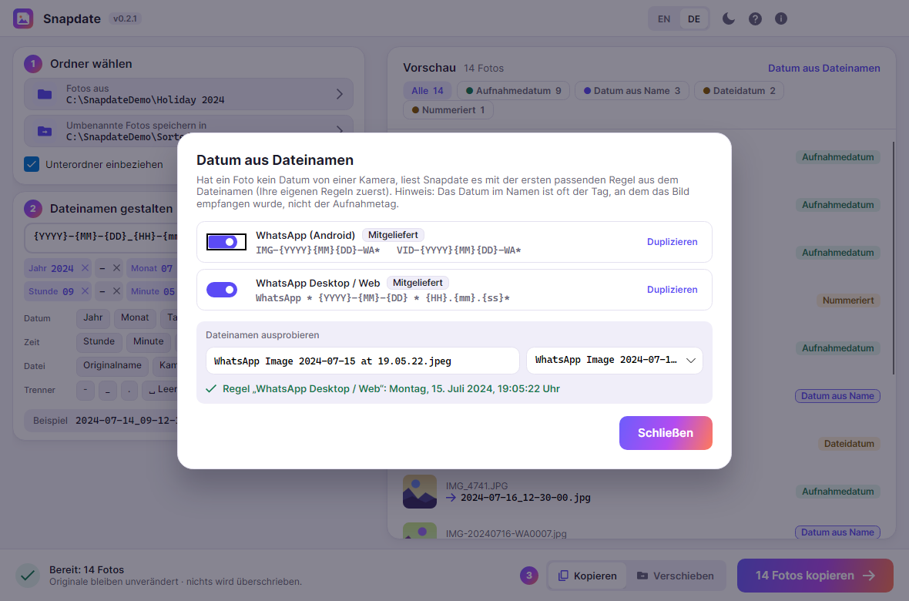

- **Mitgelieferte Regeln** kommen mit Snapdate: *WhatsApp (Android)* und
  *WhatsApp Desktop / Web*. Sie können sie nicht ändern, aber mit dem Schalter
  links **ausschalten** oder mit **Duplizieren** eine eigene Kopie anlegen, die
  Sie ändern können.
- **Ihre eigenen Regeln** sind mit *Eigene* markiert. Sie werden immer **vor**
  den mitgelieferten geprüft, und Updates ändern sie nie. Mit **Bearbeiten**
  und **Löschen** ändern oder entfernen Sie sie.
- Die erste Regel, die zu einem Namen passt, wird verwendet. Jede Änderung wird
  sofort gespeichert; die Vorschau wird aktualisiert, wenn Sie das Fenster
  schließen.
- **Dateinamen ausprobieren:** Tippen Sie einen Namen ein oder wählen Sie einen
  aus Ihrem Fotoordner. Snapdate zeigt, welche Regel welches Datum liest —
  oder *Keine Regel passt*. Dann legt **Regel aus diesem Namen erstellen** eine
  neue Regel für solche Namen an.

### ✏️ Eigene Regeln

Klicken Sie auf **Regel hinzufügen** (oder **Bearbeiten**). Geben Sie der Regel
einen Namen und beschreiben Sie, wie Ihre Dateinamen aussehen — ein Muster pro
Zeile, bis zu 10. Klicken Sie auf die Bausteine unter dem Feld, um sie an der
Cursorposition einzufügen:

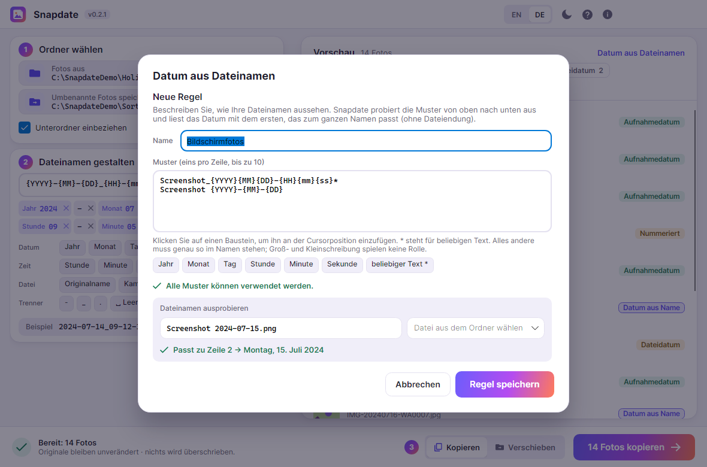

| Baustein | Code | Passt zu |
|---|---|---|
| Jahr | `{YYYY}` · `{YY}` | `2024` · `24` |
| Monat | `{MM}` · `{M}` | `07` · `7` oder `07` |
| Tag | `{DD}` · `{D}` | `04` · `4` oder `04` |
| Stunde | `{HH}` · `{H}` | `09` · `9` oder `09` |
| Minute | `{mm}` · `{m}` | `05` · `5` oder `05` |
| Sekunde | `{ss}` · `{s}` | `08` · `8` oder `08` |
| Beliebiger Text | `*` | alles, auch nichts |
| Ein Zeichen | `?` | genau ein Zeichen |

- Ein Muster braucht **Jahr, Monat und Tag**. Stunde und Minute gehören
  zusammen; Sekunden brauchen Minuten. Jeder Teil darf nur einmal vorkommen.
- Das Muster muss zum **ganzen Namen ohne Dateiendung** passen — so passt
  `IMG_{YYYY}{MM}{DD}_*` zu `IMG_20240714_153208.jpg`. Groß- und
  Kleinschreibung spielen keine Rolle. Alles andere muss genau so im Namen
  stehen.
- `*` und `?` können in Windows-Dateinamen nicht vorkommen, deshalb werden sie
  nie mit Ihrem Text verwechselt. Eine geschweifte Klammer selbst schreiben Sie
  doppelt: `{{` oder `}}`.
- Die kurzen Bausteine `{M}`, `{D}`, `{H}`, `{m}`, `{s}` brauchen etwas
  Eindeutiges daneben: Bei `{M}{D}` wäre `1 12` nicht von `11 2` zu
  unterscheiden. Setzen Sie ein Trennzeichen dazwischen oder verwenden Sie
  `{MM}{DD}`.
- Unter dem Feld erklärt Snapdate jede Zeile, die nicht verwendet werden kann,
  in einfachen Worten. Der Test zeigt, welche Zeile zu einem Namen passt und
  welches Datum sie liest — oder dass eine Zeile passt, `2024-13-45` aber kein
  Datum ist.

### 🧪 Erweitert: reguläre Ausdrücke

Wenn Sie **reguläre Ausdrücke** kennen, setzen Sie im Editor das Häkchen bei
**Erweitert: reguläre Ausdrücke**. Ihr Text bleibt beim Umschalten erhalten.
Kennzeichnen Sie die Datumsteile mit benannten Gruppen: `year` (oder `yy` für
zwei Ziffern), `month` und `day`, optional `hour`, `minute` und `second`.
Zum Beispiel:

```
^IMG-(?<year>\d{4})(?<month>\d{2})(?<day>\d{2})-WA\d+$
```

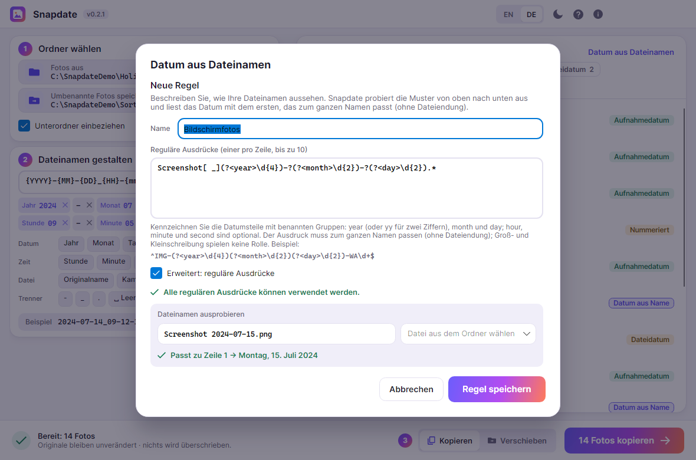

Damit der Vergleich schnell und sicher bleibt, akzeptiert Snapdate nur einen
einfachen Teil der Sprache für reguläre Ausdrücke:

- **Erlaubt:** normale Zeichen, `\d \s \w .`, einfache Klassen wie `[a-z_-]`
  oder `[^0-9]`, Gruppen `( )`, `(?: )` und die benannten Gruppen oben,
  Alternativen mit `|`, `^` und `$` sowie Wiederholungen (`* + ? {n} {n,m}`)
  mit Anzahlen bis 20.
- Der Ausdruck muss zum **ganzen Namen** ohne Dateiendung passen; Groß- und
  Kleinschreibung spielen keine Rolle. Höchstens 300 Zeichen pro Zeile.
- Ein Teil, **dessen Länge sich ändern kann** — etwa `.*`, `x?` oder
  unterschiedlich lange Alternativen wie `(?:a|bc)` — **kann nicht noch einmal
  wiederholt** werden. Schreiben Sie die Teile stattdessen nacheinander aus.
- Pro Ausdruck sind nur wenige offene Wiederholungen (`*`, `+`, `{n,}`)
  erlaubt; sehr lange oder komplizierte Ausdrücke werden abgelehnt.
- **Nicht verfügbar:** Lookarounds, Rückverweise, Optionen wie `(?i)`, `\b`,
  `\p{…}` und andere Buchstaben-Escapes.

Was nicht verwendet werden kann, wird in einfachen Worten erklärt; der Test
probiert einen Namen kurz nachdem Sie aufgehört haben zu tippen.

---

## 🧩 10. Alle Bausteine (Platzhalter)

Im Feld erscheint jeder Baustein als kurzer Code in geschweiften Klammern. Sie
können die Codes auch selbst tippen. **Groß- und Kleinschreibung zählt**: `MM`
ist der Monat, `mm` die Minute.

| Baustein | Code | Beispiel |
|---|---|---|
| Jahr | `{YYYY}` · `{YY}` | `2024` · `24` |
| Monat | `{MM}` · `{M}` | `07` · `7` |
| Monatsname | `{MMM}` · `{MMMM}` | `Jul` · `Juli` |
| Tag | `{DD}` · `{D}` | `04` · `4` |
| Wochentag | `{ddd}` · `{dddd}` | `Do` · `Donnerstag` |
| Stunde (24 h) | `{HH}` · `{H}` | `09` · `9` |
| Minute | `{mm}` · `{m}` | `05` · `5` |
| Sekunde | `{ss}` · `{s}` | `08` · `8` |
| Originalname | `{name}` | `IMG_4711` |
| Kamera | `{camera}` | `iPhone 15 Pro` |
| Zähler | `{counter}` | `001`, `002`, … (in Datumsreihenfolge) |

Alles außerhalb von `{…}` bleibt genau so, wie Sie es tippen. Eine geschweifte
Klammer selbst schreiben Sie doppelt: `{{` oder `}}`.

**Unterstützte Dateien:** JPG, PNG, HEIC/HEIF, AVIF, WebP, TIFF, GIF, BMP,
Kamera-RAW (DNG, CR2, CR3, NEF, ARW, ORF, RW2, RAF, PEF, …) und Videos (MP4,
MOV, M4V, 3GP).

---

## 💿 11. Installation

Der Installer ist der empfohlene Weg. Er legt Snapdate wie jedes andere
Programm im Startmenü an und ermöglicht es, dass Snapdate Sie über neue
Versionen informiert.

1. Laden Sie `Snapdate-Setup-vX.Y.Z-win-x64.exe` herunter (ARM-Geräte:
   `…-win-arm64.exe`) und doppelklicken Sie darauf.
2. Wählen Sie, **für wen** Snapdate installiert wird:

   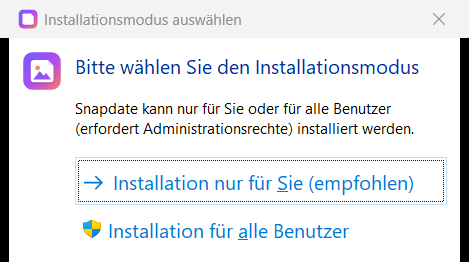

   | Auswahl | Bedeutung |
   |---|---|
   | **Installation nur für Sie** *(empfohlen)* | Nur Ihr Windows-Konto. Es werden keine Administratorrechte benötigt. |
   | **Installation für alle Benutzer** | Alle Konten auf diesem PC. Windows fragt nach der Zustimmung eines Administrators. |

3. Fragt der Installer zuerst nach der **Sprache**, wählen Sie Deutsch oder
   Englisch. Klicken Sie sich dann mit **Weiter** durch die Schritte. Den
   vorgeschlagenen Ordner können Sie behalten. Die **Desktop-Verknüpfung** ist
   standardmäßig angehakt (nehmen Sie das Häkchen heraus, wenn Sie sie nicht
   möchten); der Eintrag im **Startmenü** wird immer angelegt.
4. Klicken Sie auf **Installieren** und dann auf **Fertigstellen**. Snapdate
   startet, wenn das Häkchen bei „Snapdate starten“ gesetzt bleibt.

> ⚠️ **Windows zeigt eventuell eine Warnung** („Der Computer wurde durch Windows
> geschützt“, *SmartScreen*), wenn Sie den Installer oder Snapdate zum ersten
> Mal öffnen. Snapdate ist neu und noch nicht mit einem kostenpflichtigen
> Zertifikat signiert, deshalb kennt Windows es noch nicht. Klicken Sie auf
> **Weitere Informationen** und dann auf **Trotzdem ausführen**. Wenn Sie die
> Datei vorher prüfen möchten, finden Sie die Prüfsumme in den Release-Hinweisen
> (`SHA256SUMS.txt`; in PowerShell: `Get-FileHash <Datei> -Algorithm SHA256`).

**Eine neuere Version installieren** geht genauso: Starten Sie den neuen
Installer. Er aktualisiert Snapdate an Ort und Stelle und **behält Ihre
Einstellungen**.

---

## 🧳 12. Portable Version

Die **portable** Datei braucht keine Installation:

1. Laden Sie `Snapdate-vX.Y.Z-win-x64-portable.exe` herunter (ARM-Geräte:
   `…-win-arm64-portable.exe`).
2. Speichern Sie sie, wo Sie möchten — etwa im Ordner Dokumente oder auf einem
   USB-Stick — und doppelklicken Sie darauf.

Es wird nichts im Startmenü oder unter *Einstellungen → Apps* eingetragen. Zum
Entfernen löschen Sie einfach die Datei. Ihre Einstellungen liegen in
`%APPDATA%\Snapdate` (siehe Fragen am Ende); löschen Sie auch diesen Ordner,
wenn alles verschwinden soll.

Die portable Version **aktualisiert sich nicht selbst**. Gibt es eine neue
Version, zeigt sie einen Hinweis mit dem Knopf **Herunterladen**, der die
Download-Seite öffnet — dort laden Sie die neue Datei erneut herunter (siehe
[Updates](#-13-updates)).

---

## 🔔 13. Updates

Snapdate prüft **höchstens einmal täglich** beim Start, ob es eine neuere
Version gibt. Dafür fragt es bei GitHub (`api.github.com`) nur nach der neuesten
Versionsnummer. Es werden **keine Fotos, keine Dateinamen und keine persönlichen
Daten** gesendet — GitHub sieht Ihre IP-Adresse, wie bei jeder Webseite, die Sie
besuchen.

**Erster Start:** Snapdate zeigt nur einen kurzen Hinweis, der das erklärt. Die
erste Prüfung findet beim nächsten Start statt. Mit **Verstanden** schließen Sie
den Hinweis. Schalten Sie die automatische Prüfung zwischenzeitlich aus,
verschwindet der Hinweis ebenfalls.


**Gibt es eine neue Version**, erscheint oben ein schmaler Hinweis:

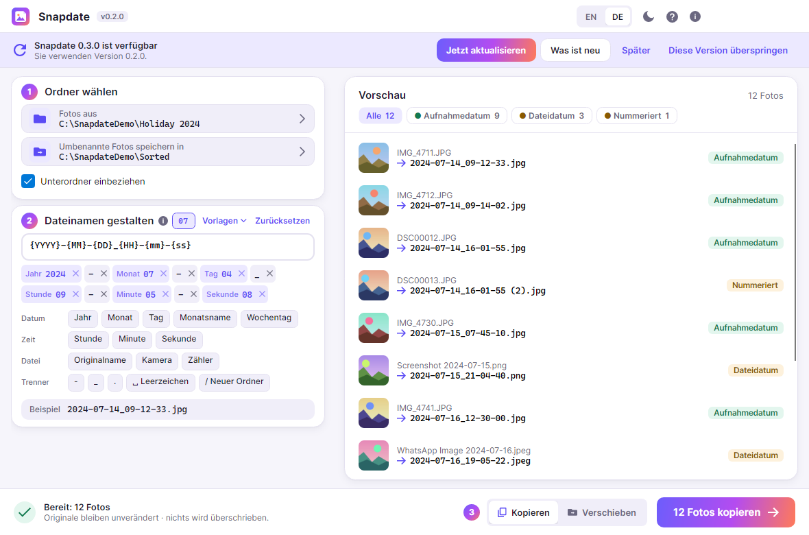

| Knopf | Was er tut |
|---|---|
| **Jetzt aktualisieren** | Nur bei der installierten Version. Der Hinweis zeigt den Fortschritt des Downloads (mit **Abbrechen**), danach prüft Snapdate die Signatur des Downloads und startet das Installationsprogramm. Bei einer Installation „für alle Benutzer“ fragt Windows zuerst nach der Zustimmung eines Administrators (dafür dürfen Sie sich beliebig Zeit lassen). Snapdate schließt sich dann selbst und startet in der neuen Version neu. Lehnen Sie die Zustimmung ab, bleibt alles unverändert. |
| **Was ist neu** | Öffnet die Versionshinweise im Browser. |
| **Später** | Blendet den Hinweis bis zum nächsten Start aus; bei der nächsten automatischen Prüfung erscheint er wieder. |
| **Diese Version überspringen** | Keine automatischen Erinnerungen mehr für diese Version. Eine neuere wird wieder gemeldet. **Jetzt prüfen** (siehe unten) zeigt eine übersprungene Version trotzdem an. |

Schlägt der Download, die Prüfung der Signatur oder die Installation fehl (oder
lehnen Sie die Zustimmung ab), wird **nichts
installiert**; der Hinweis sagt das kurz und bietet **Erneut versuchen** (wo das helfen kann) und **Download-Seite öffnen** an.

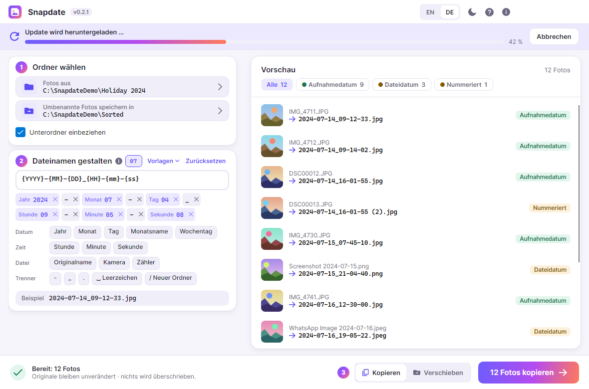

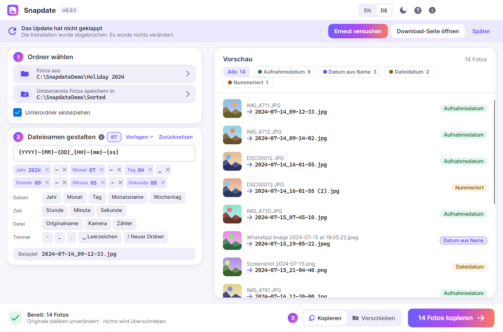

**Portable Version:** Statt *Jetzt aktualisieren* gibt es den Knopf
**Herunterladen**. Er öffnet die neueste Download-Seite, wo Sie die neue portable
Datei erneut herunterladen.

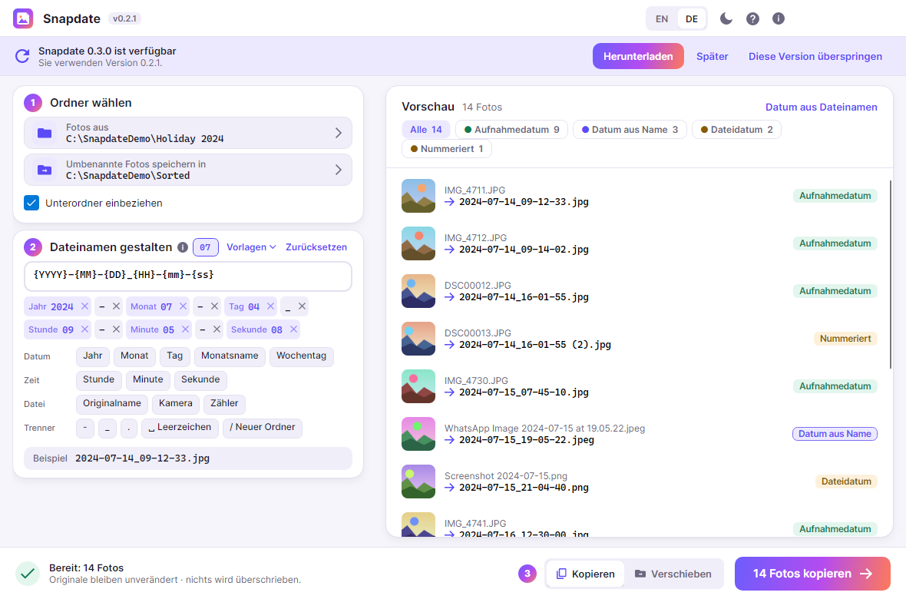

**Ausschalten, von Hand prüfen:** Klicken Sie oben rechts auf den Knopf **ⓘ**
(*Über Snapdate*). Dort können Sie das Häkchen bei **Automatisch nach Updates
suchen** entfernen oder jederzeit auf **Jetzt prüfen** klicken.


Sind Sie offline, passiert nichts Schlimmes: Die automatische Prüfung bleibt
einfach still, und Snapdate arbeitet normal weiter. Nur wenn Sie auf
**Jetzt prüfen** klicken, meldet es *„Prüfung gerade nicht möglich — sind Sie
offline?“*.

---

## 🗑️ 14. Deinstallation

1. Öffnen Sie in Windows **Einstellungen → Apps → Installierte Apps** (Windows 10:
   *Apps & Features*).
2. Suchen Sie **Snapdate**, wählen Sie **Deinstallieren** und folgen Sie den
   Schritten.

Haben Sie **nur für sich** installiert, fragt Snapdate, ob **auch Ihre
Einstellungen gelöscht** werden sollen (gemerkte Ordner, Dateinamen-Muster,
Sprache) **und Ihre eigenen Datumsregeln**. Wählen Sie **Nein**, um sie zu behalten — praktisch, wenn Sie
Snapdate später erneut installieren möchten. Bei einer Installation für **alle
Benutzer** bleiben die Einstellungen immer erhalten.

Ihre Fotos und umbenannten Dateien werden nie angefasst. Die portable Version
hat kein Deinstallationsprogramm: Löschen Sie einfach die Datei.

---

## ❓ 15. Fragen & Antworten

**Werden meine Fotos verändert?**
Nein. Mit **Kopieren** werden Originale nie angefasst. Auch die Bilder selbst
werden nicht verändert — nur die Dateinamen der Kopien sind anders.

**Kann Snapdate etwas überschreiben?**
Nein. Gibt es einen Namen im Zielordner schon, ergänzt Snapdate `(2)`, `(3)` …

**Sendet Snapdate etwas ins Internet?**
Snapdate arbeitet offline — bis auf die optionale Update-Prüfung. Höchstens
einmal täglich fragt es bei GitHub nach der neuesten Versionsnummer; Ihre Fotos,
Dateinamen und persönlichen Daten werden nie gesendet (GitHub sieht Ihre
IP-Adresse, wie jede Webseite). Die Prüfung können Sie unter *Über Snapdate* →
**Automatisch nach Updates suchen** ausschalten. Es gibt kein Konto und kein
Tracking. Die Knöpfe **?** und *Projektseite* öffnen eine Webseite, und zwar nur,
wenn Sie darauf klicken.

**Warum steht bei manchen Fotos „Dateidatum“?**
Screenshots und Bilder aus Chats oder sozialen Netzwerken enthalten oft kein
Datum. Steht auch im Namen keines, ist das Datum der Datei das Beste, was
Snapdate finden kann. Für Namen mit Datum siehe
[Datum aus Dateinamen](#-9-datum-aus-dateinamen).

**Meine WhatsApp-Fotos von einem iPhone haben kein Datum.**
Ein iPhone speichert Bilder aus WhatsApp mit Namen wie `IMG_4200.jpg` — im
Namen steht kein Datum und in der Datei auch nicht. Bitten Sie die Absenderin
oder den Absender, die Fotos **„als Dokument“** zu senden (WhatsApp behält dann
die Originaldatei mit ihrem Datum), oder kopieren Sie die Bilder bald nach dem
Empfang, damit das Dateidatum nah am richtigen Tag liegt.

**Warum steht bei einem Foto „Daten weichen ab“?**
Es hatte zwei Daten an verschiedenen Tagen, z. B. eines im Namen und eines, das
eine App in die Datei geschrieben hat. Zeigen Sie mit der Maus auf den Hinweis,
um zu sehen, welches Datum verwendet und welches ignoriert wurde. Siehe
[Woher kommt das Datum?](#-8-woher-kommt-das-datum).

**Wo werden meine eigenen Datumsregeln gespeichert?**
In `%APPDATA%\Snapdate\date-rules.json`, neben den Einstellungen. Updates
ändern diese Datei nie. Kann sie einmal nicht gelesen werden, funktionieren die
mitgelieferten Regeln weiter, und Snapdate behält eine Kopie der alten Datei,
bevor es eine neue speichert.

**Wozu ist die Protokolldatei?**
Sie listet auf, was von wo nach wo kopiert oder verschoben wurde. Sie können
sie jederzeit löschen.

**Meine Handyfotos liegen in vielen Unterordnern.**
Setzen Sie das Häkchen bei **Unterordner einbeziehen** und wählen Sie den
Hauptordner (z. B. `DCIM`).

**Wo speichert Snapdate seine Einstellungen?**
In `%APPDATA%\Snapdate\settings.json` (zuletzt gewählte Ordner, Ihr
Namensmuster, Sprache). Löschen Sie die Datei, um neu zu beginnen.

---

<sub>Ein Problem gefunden oder eine Idee? Eröffnen Sie ein Issue auf
[GitHub](https://github.com/jannikjordan/snapdate/issues).</sub>
