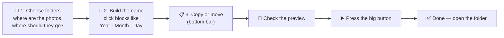
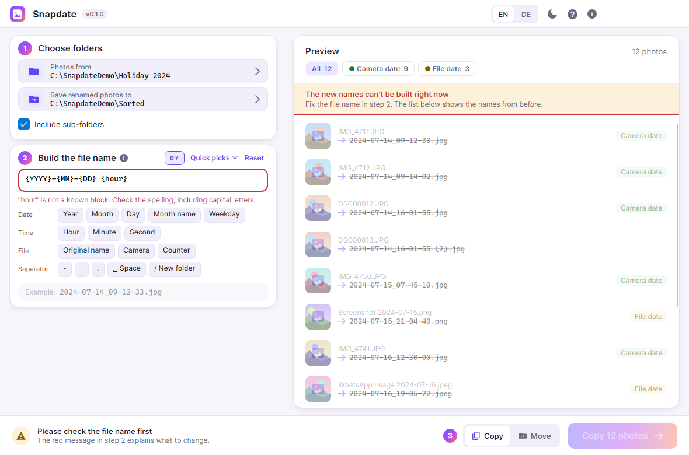
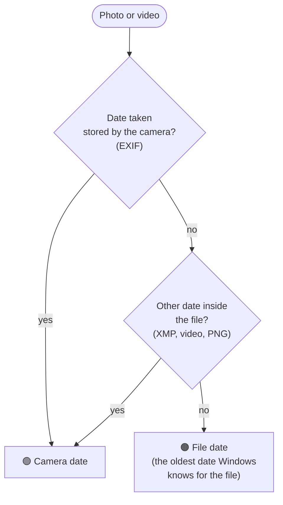

<p align="center"></p>

# 📖 Snapdate — User guide

🇬🇧 English · [🇩🇪 Deutsch](user-guide.de.md)

Snapdate gives your photos **clear names based on the day they were taken**.
Instead of `IMG_4711.JPG`, `DSC00012.JPG` and `WhatsApp Image….jpeg` you get
`2024-07-14_09-12-33.jpg` — and all your pictures line up in the right order,
in any folder, on any computer.

> 💡 **You can't break anything.** Snapdate *copies* your photos by default and
> **never overwrites** a file. Your originals stay exactly where they are.

---

## Contents

1. [Getting started](#-1-getting-started)
2. [The three steps at a glance](#-2-the-three-steps-at-a-glance)
3. [Step 1 — Choose folders](#-3-step-1--choose-folders)
4. [Step 2 — Build the file name](#-4-step-2--build-the-file-name)
5. [Step 3 — Copy or move](#-5-step-3--copy-or-move)
6. [Check the preview](#-6-check-the-preview)
7. [Go!](#-7-go)
8. [Where does the date come from?](#-8-where-does-the-date-come-from)
9. [All blocks (placeholders)](#-9-all-blocks-placeholders)
10. [Questions & answers](#-10-questions--answers)

---

## 🚀 1. Getting started

1. Download `Snapdate-…-win-x64.exe` from the
   [Releases page](https://github.com/jannikjordan/snapdate/releases).
   (On ARM devices such as Surface Pro X or Copilot+ PCs, pick `win-arm64`.)
2. Double-click the file. There is **nothing to install**.
3. Windows may show *“Windows protected your PC”* the first time, because the
   app is new. Click **More info → Run anyway**.

Snapdate speaks **English and German**. It picks the language of your Windows
automatically — you can switch any time with **EN | DE** at the top right.
The 🌙 button switches between light and dark, **?** opens this guide.


---

## 🧭 2. The three steps at a glance



Nothing happens to your files until you press the big button at the bottom
right. Until then, everything is just a preview.

---

## 📁 3. Step 1 — Choose folders

| Box | What to choose |
|---|---|
| **Photos from** | The folder that holds your pictures, e.g. your phone backup or SD card. |
| **Save renamed photos to** | Where the renamed copies should go, e.g. a new folder *“Photos sorted”*. |

Click a box to pick a folder — or simply **drag a folder from Explorer onto
the box**.

**Include sub-folders** — when ticked, Snapdate also looks inside every folder
within your photo folder. Handy for phone backups like `DCIM\100APPLE`, `DCIM\101APPLE` …

> ⚠️ The target folder must not be *inside* the photo folder while
> “Include sub-folders” is on — otherwise Snapdate would find its own copies
> next time. Snapdate tells you if that happens.


---

## 🧩 4. Step 2 — Build the file name

Here you decide what the new names look like. You don't need to type anything
special — just **click the blocks**:

| Group | Blocks |
|---|---|
| **Date** | Year · Month · Day · Month name · Weekday |
| **Time** | Hour · Minute · Second |
| **File** | Original name · Camera · Counter |
| **Separator** | `-` · `_` · `.` · Space · New folder (`/`) |

Every click adds the block where your cursor is in the box above. The row of
coloured blocks under the box shows what you built, with an example value:

- **Click a block** to switch its form: `07 ⇄ 7`, `2024 ⇄ 24`, `Jul ⇄ July`, `Sun ⇄ Sunday`.
- **Click the ✕** next to a block to remove it.
- The small **07** button next to the title switches all date and time blocks between `07` and `7` at once.

### ✍️ Your own text

You can type **any text** into the box, anywhere between the blocks — for
example `Holiday ` in front of the date:

```
Holiday {D}.{M}.{YYYY} {HH}{mm}   →   Holiday 14.7.2024 0912.jpg
```


### 🗂️ Sort into folders

The **New folder** block (`/`) puts photos into sub-folders. For example one
folder per year and month:

```
{YYYY}/{MM}/{YYYY}-{MM}-{DD} {name}   →   2024\07\2024-07-14 IMG_4711.jpg
```


### ⚡ Quick picks

Don't want to build anything? Open **Quick picks ▾** next to the title — the entries show
exactly how the result will look. **Reset** brings back the standard name.

> 💡 The file type (`.jpg`, `.png`, `.heic` …) is **always kept automatically**.
> You never need to add it.

If something in the box can't work (for example a character Windows doesn't
allow in file names, like `:` or `?`), the box turns red and tells you in plain
words what to fix:



While the file name can't be used, the preview on the right is dimmed, the new
names are struck through and a red note says the names can't be built right now.
The list stays so you don't lose your place. Fix the file name and the preview
updates by itself. The **Copy** button stays off until then.

---

## 📋 5. Step 3 — Copy or move

You find this choice in the **bar at the bottom**, right next to the big
button: **Copy** or **Move**.


| Option | What happens | When to use |
|---|---|---|
| **Copy** *(recommended)* | Your originals stay untouched; renamed copies are created. | Almost always. Safest choice. |
| **Move** | The photos are moved to the target folder with their new names. | When you want to tidy up and have a backup. |

When moving, Snapdate first makes a **verified copy**, and only then removes
the original. On the same drive it simply renames — instantly and safely.
Before moving, Snapdate asks you once more:


---

## 👀 6. Check the preview

On the right you see every photo: a small picture, the **old name** in grey and
the **new name** in bold. A coloured label tells you where the date came from:

| Label | Meaning |
|---|---|
| 🟢 **Camera date** | The date was read from the photo itself — the moment the picture was taken. |
| 🟠 **File date** | The file has no date inside (common for screenshots and chat pictures), so the date of the file was used. |
| 🟠 **Numbered** | Two photos would get the same name (e.g. taken in the same second), so `(2)`, `(3)` … was added. |

Use the tabs **All · Camera date · File date · Numbered** to look at just one
group.

---

## ▶️ 7. Go!

When everything looks right, press **Copy 12 photos** (or **Move …**) at the
bottom right. A progress bar shows how far Snapdate is; you can **Cancel** at
any time — files not yet processed stay untouched.

When it's done you can **open the folder** straight away. Snapdate also saves a
small **log file** (`snapdate-log-….csv`) in the target folder, listing every
old and new name — you can open it with Excel.


---

## 🔍 8. Where does the date come from?

Snapdate looks for the date in this order and takes the first one it finds:



Dates that cannot be right — far in the future or before 1900 — are ignored.

---

## 🧩 9. All blocks (placeholders)

In the box, each block appears as a short code in curly braces. You can also
type these codes yourself. **Upper and lower case matter**: `MM` is the month,
`mm` the minute.

| Block | Code | Example |
|---|---|---|
| Year | `{YYYY}` · `{YY}` | `2024` · `24` |
| Month | `{MM}` · `{M}` | `07` · `7` |
| Month name | `{MMM}` · `{MMMM}` | `Jul` · `July` |
| Day | `{DD}` · `{D}` | `04` · `4` |
| Weekday | `{ddd}` · `{dddd}` | `Thu` · `Thursday` |
| Hour (24 h) | `{HH}` · `{H}` | `09` · `9` |
| Minute | `{mm}` · `{m}` | `05` · `5` |
| Second | `{ss}` · `{s}` | `08` · `8` |
| Original name | `{name}` | `IMG_4711` |
| Camera | `{camera}` | `iPhone 15 Pro` |
| Counter | `{counter}` | `001`, `002`, … (in date order) |

Everything outside `{…}` is kept exactly as typed. To write a curly brace
itself, type it twice: `{{` or `}}`.

**Supported files:** JPG, PNG, HEIC/HEIF, AVIF, WebP, TIFF, GIF, BMP, camera
RAW (DNG, CR2, CR3, NEF, ARW, ORF, RW2, RAF, PEF, …) and videos (MP4, MOV, M4V, 3GP).

---

## ❓ 10. Questions & answers

**Will my photos be changed?**
No. With **Copy**, originals are never touched. Even the photos themselves are
not modified — only the file names of the copies differ.

**Can Snapdate overwrite something?**
No. If a name already exists in the target folder, Snapdate adds `(2)`, `(3)` …

**Does Snapdate send anything to the internet?**
No. Snapdate works completely offline — no account, no tracking. Only the
**?** and *Project website* buttons open a web page, and only when you click them.

**Why do some photos say “File date”?**
Screenshots, pictures saved from chats or social media often have no
date inside. Then the date of the file is the best Snapdate can do.

**What is the log file for?**
It lists what was copied or moved, from where to where. You can delete it at
any time.

**My phone photos are in many sub-folders.**
Tick **Include sub-folders** and choose the main folder (e.g. `DCIM`).

**Where does Snapdate keep its settings?**
In `%APPDATA%\Snapdate\settings.json` (last folders, your name pattern,
language). Delete the file to start fresh.

---

<sub>Found a problem or have an idea? Open an issue on
[GitHub](https://github.com/jannikjordan/snapdate/issues).</sub>
