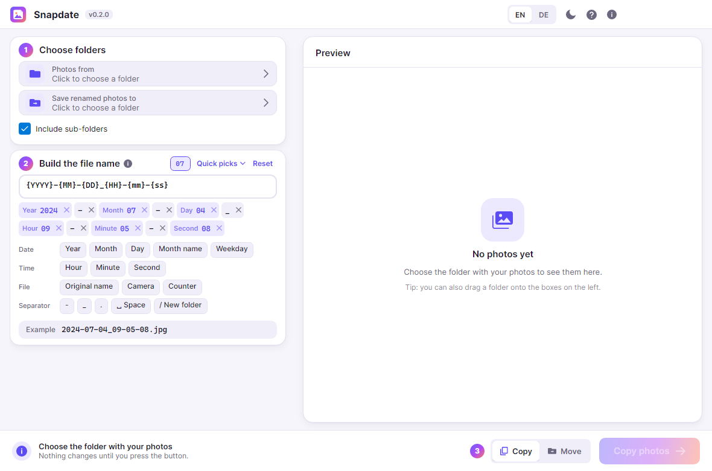
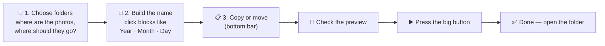
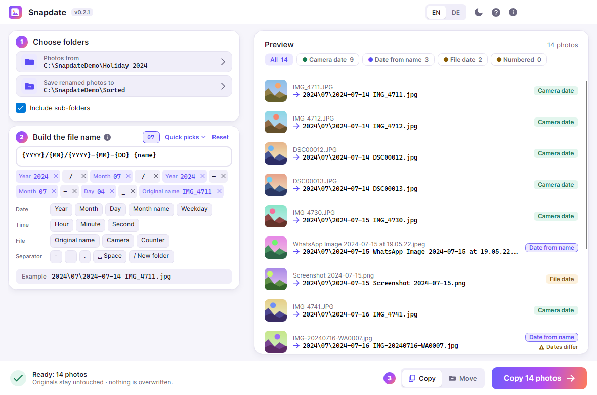
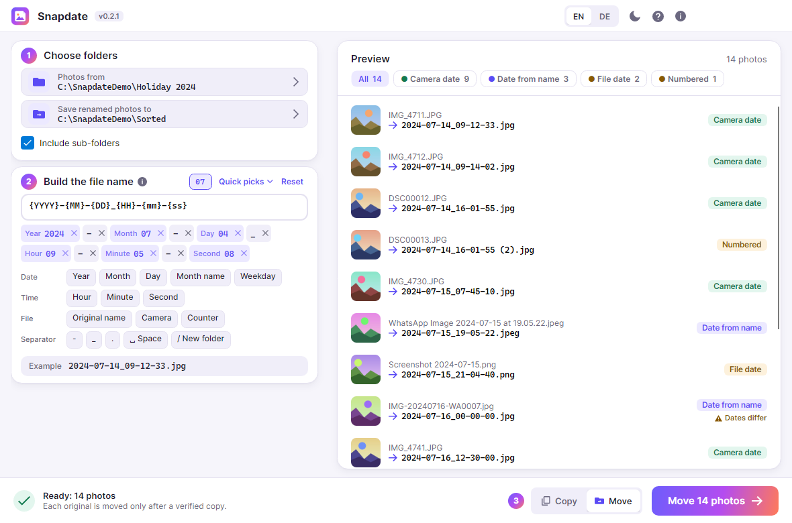
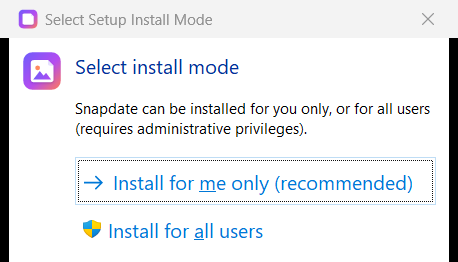
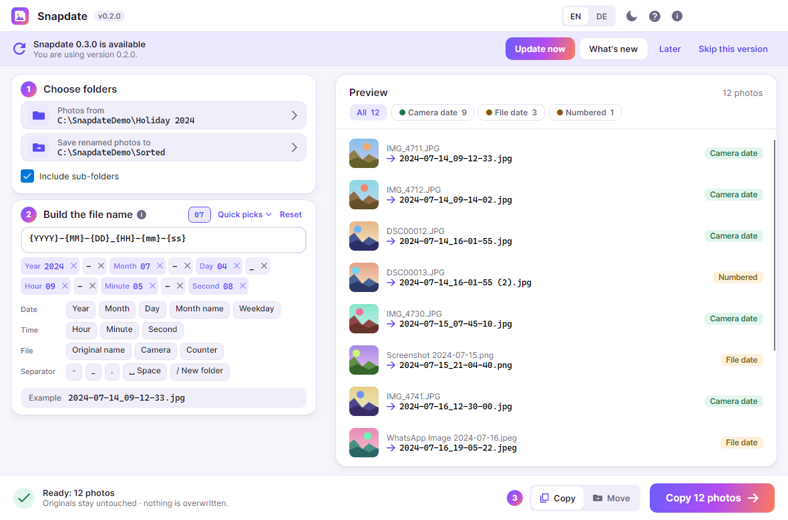
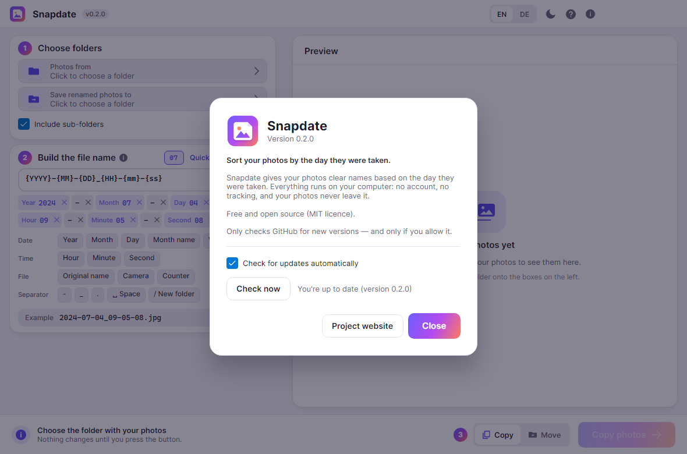

<p align="center"></p>

# 📖 Snapdate — User guide

🇬🇧 English · [🇩🇪 Deutsch](user-guide.de.md)

Snapdate gives your photos **clear names based on the day they were taken**.
Instead of `IMG_4711.JPG`, `DSC00012.JPG` and `WhatsApp Image….jpeg` you get
`2024-07-14_09-12-33.jpg` — and all your pictures line up in the right order,
in any folder, on any computer.

> 💡 **You can't break anything.** Snapdate *copies* your photos by default and
> **never overwrites** a file. Your originals stay exactly where they are.

---

## Contents

1. [Getting started](#-1-getting-started)
2. [The three steps at a glance](#-2-the-three-steps-at-a-glance)
3. [Step 1 — Choose folders](#-3-step-1--choose-folders)
4. [Step 2 — Build the file name](#-4-step-2--build-the-file-name)
5. [Step 3 — Copy or move](#-5-step-3--copy-or-move)
6. [Check the preview](#-6-check-the-preview)
7. [Go!](#-7-go)
8. [Where does the date come from?](#-8-where-does-the-date-come-from)
9. [All blocks (placeholders)](#-9-all-blocks-placeholders)
10. [Install](#-10-install)
11. [Portable version](#-11-portable-version)
12. [Updates](#-12-updates)
13. [Uninstall](#-13-uninstall)
14. [Questions & answers](#-14-questions--answers)

---

## 🚀 1. Getting started

1. Download the installer `Snapdate-Setup-vX.Y.Z-win-x64.exe` from the
   [Releases page](https://github.com/jannikjordan/snapdate/releases/latest).
   (On ARM devices such as Surface Pro X or Copilot+ PCs, pick `win-arm64`.)
2. Double-click it and follow the steps — details in
   [Install](#-10-install). Then start **Snapdate** from the Start menu.
3. Windows may show *“Windows protected your PC”* the first time, because the
   app is new. Click **More info → Run anyway**.

> 💡 You'd rather not install anything? Use the **portable** file instead
> (`Snapdate-vX.Y.Z-win-x64-portable.exe`): just double-click it. See
> [Portable version](#-11-portable-version).

Snapdate speaks **English and German**. It picks the language of your Windows
automatically — you can switch any time with **EN | DE** at the top right.
The 🌙 button switches between light and dark, **?** opens this guide.



---

## 🧭 2. The three steps at a glance



Nothing happens to your files until you press the big button at the bottom
right. Until then, everything is just a preview.

---

## 📁 3. Step 1 — Choose folders

| Box | What to choose |
|---|---|
| **Photos from** | The folder that holds your pictures, e.g. your phone backup or SD card. |
| **Save renamed photos to** | Where the renamed copies should go, e.g. a new folder *“Photos sorted”*. |

Click a box to pick a folder — or simply **drag a folder from Explorer onto
the box**.

**Include sub-folders** — when ticked, Snapdate also looks inside every folder
within your photo folder. Handy for phone backups like `DCIM\100APPLE`, `DCIM\101APPLE` …

> ⚠️ The target folder must not be *inside* the photo folder while
> “Include sub-folders” is on — otherwise Snapdate would find its own copies
> next time. Snapdate tells you if that happens.


---

## 🧩 4. Step 2 — Build the file name

Here you decide what the new names look like. You don't need to type anything
special — just **click the blocks**:

| Group | Blocks |
|---|---|
| **Date** | Year · Month · Day · Month name · Weekday |
| **Time** | Hour · Minute · Second |
| **File** | Original name · Camera · Counter |
| **Separator** | `-` · `_` · `.` · Space · New folder (`/`) |

Every click adds the block where your cursor is in the box above. The row of
coloured blocks under the box shows what you built, with an example value:

- **Click a block** to switch its form: `07 ⇄ 7`, `2024 ⇄ 24`, `Jul ⇄ July`, `Sun ⇄ Sunday`.
- **Click the ✕** next to a block to remove it.
- The small **07** button next to the title switches all date and time blocks between `07` and `7` at once.

### ✍️ Your own text

You can type **any text** into the box, anywhere between the blocks — for
example `Holiday ` in front of the date:

```
Holiday {D}.{M}.{YYYY} {HH}{mm}   →   Holiday 14.7.2024 0912.jpg
```


### 🗂️ Sort into folders

The **New folder** block (`/`) puts photos into sub-folders. For example one
folder per year and month:

```
{YYYY}/{MM}/{YYYY}-{MM}-{DD} {name}   →   2024\07\2024-07-14 IMG_4711.jpg
```



### ⚡ Quick picks

Don't want to build anything? Open **Quick picks ▾** next to the title — the entries show
exactly how the result will look. **Reset** brings back the standard name.

> 💡 The file type (`.jpg`, `.png`, `.heic` …) is **always kept automatically**.
> You never need to add it.

If something in the box can't work (for example a character Windows doesn't
allow in file names, like `:` or `?`), the box turns red and tells you in plain
words what to fix:


While the file name can't be used, the preview on the right is dimmed, the new
names are struck through and a red note says the names can't be built right now.
The list stays so you don't lose your place. Fix the file name and the preview
updates by itself. The **Copy** button stays off until then.

---

## 📋 5. Step 3 — Copy or move

You find this choice in the **bar at the bottom**, right next to the big
button: **Copy** or **Move**.



| Option | What happens | When to use |
|---|---|---|
| **Copy** *(recommended)* | Your originals stay untouched; renamed copies are created. | Almost always. Safest choice. |
| **Move** | The photos are moved to the target folder with their new names. | When you want to tidy up and have a backup. |

When moving, Snapdate first makes a **verified copy**, and only then removes
the original. On the same drive it simply renames — instantly and safely.
Before moving, Snapdate asks you once more:


---

## 👀 6. Check the preview

On the right you see every photo: a small picture, the **old name** in grey and
the **new name** in bold. A coloured label tells you where the date came from:

| Label | Meaning |
|---|---|
| 🟢 **Camera date** | The date was read from the photo itself — the moment the picture was taken. |
| 🟠 **File date** | The file has no date inside (common for screenshots and chat pictures), so the date of the file was used. |
| 🟠 **Numbered** | Two photos would get the same name (e.g. taken in the same second), so `(2)`, `(3)` … was added. |

Use the tabs **All · Camera date · File date · Numbered** to look at just one
group.

---

## ▶️ 7. Go!

When everything looks right, press **Copy 12 photos** (or **Move …**) at the
bottom right. A progress bar shows how far Snapdate is; you can **Cancel** at
any time — files not yet processed stay untouched.

When it's done you can **open the folder** straight away. Snapdate also saves a
small **log file** (`snapdate-log-….csv`) in the target folder, listing every
old and new name — you can open it with Excel.


---

## 🔍 8. Where does the date come from?

Snapdate looks for the date in this order and takes the first one it finds:


Dates that cannot be right — far in the future or before 1900 — are ignored.

---

## 🧩 9. All blocks (placeholders)

In the box, each block appears as a short code in curly braces. You can also
type these codes yourself. **Upper and lower case matter**: `MM` is the month,
`mm` the minute.

| Block | Code | Example |
|---|---|---|
| Year | `{YYYY}` · `{YY}` | `2024` · `24` |
| Month | `{MM}` · `{M}` | `07` · `7` |
| Month name | `{MMM}` · `{MMMM}` | `Jul` · `July` |
| Day | `{DD}` · `{D}` | `04` · `4` |
| Weekday | `{ddd}` · `{dddd}` | `Thu` · `Thursday` |
| Hour (24 h) | `{HH}` · `{H}` | `09` · `9` |
| Minute | `{mm}` · `{m}` | `05` · `5` |
| Second | `{ss}` · `{s}` | `08` · `8` |
| Original name | `{name}` | `IMG_4711` |
| Camera | `{camera}` | `iPhone 15 Pro` |
| Counter | `{counter}` | `001`, `002`, … (in date order) |

Everything outside `{…}` is kept exactly as typed. To write a curly brace
itself, type it twice: `{{` or `}}`.

**Supported files:** JPG, PNG, HEIC/HEIF, AVIF, WebP, TIFF, GIF, BMP, camera
RAW (DNG, CR2, CR3, NEF, ARW, ORF, RW2, RAF, PEF, …) and videos (MP4, MOV, M4V, 3GP).

---

## 💿 10. Install

The installer is the recommended way to get Snapdate. It puts Snapdate in the
Start menu like any other program and lets it tell you about new versions.

1. Download `Snapdate-Setup-vX.Y.Z-win-x64.exe` (ARM devices:
   `…-win-arm64.exe`) and double-click it.
2. Choose **who** should get Snapdate:

   

   | Choice | What it means |
   |---|---|
   | **Install for me only** *(recommended)* | Only your Windows account. No administrator rights needed. |
   | **Install for all users** | Every account on this PC. Windows asks for administrator approval. |

3. If the installer first asks for a **language**, pick English or German. Then
   click **Next** through the steps. You can keep the suggested folder. The
   **desktop shortcut** is ticked by default (untick it if you don't want it);
   the **Start menu** entry is always created.
4. Click **Install**, then **Finish**. Snapdate starts if you leave
   the “Launch Snapdate” box ticked.

> ⚠️ **Windows may warn you** (“Windows protected your PC”, *SmartScreen*)
> when you open the installer or Snapdate for the first time. Snapdate is new
> and not yet signed with a paid certificate, so Windows doesn't know it yet.
> Click **More info**, then **Run anyway**. If you'd like to double-check the
> file first, see the checksum in the release notes
> (`SHA256SUMS.txt`; in PowerShell: `Get-FileHash <file> -Algorithm SHA256`).

**Installing a newer version** works the same way: run the new installer. It
updates Snapdate in place and **keeps your settings**.

---

## 🧳 11. Portable version

The **portable** file needs no installation at all:

1. Download `Snapdate-vX.Y.Z-win-x64-portable.exe` (ARM devices:
   `…-win-arm64-portable.exe`).
2. Save it anywhere — your Documents folder or a USB stick — and double-click it.

It does not add anything to the Start menu or to *Settings → Apps*. To remove
it, simply delete the file. Your settings stay in `%APPDATA%\Snapdate` (see the
questions at the end); delete that folder too if you want everything gone.

The portable version **does not update itself**. When a new version is out, it
shows a banner with a **Download** button that opens the release page, so you
can download the new file again (see [Updates](#-12-updates)).

---

## 🔔 12. Updates

Snapdate checks **at most once a day**, when it starts, whether a newer version
exists. For this it only asks GitHub (`api.github.com`) for the newest version
number. It sends **no photos, no file names and no personal data** — GitHub
sees your IP address, as with any website you visit.

**First start:** Snapdate only shows a short notice that explains this. The first
check happens at the next start. Press **Got it** to close the notice. If you
switch the automatic check off in the meantime, the notice disappears too.


**When a new version is out**, a slim banner appears at the top:



| Button | What it does |
|---|---|
| **Update now** | Installed version only. Downloads the new installer from GitHub, checks its signature and installs it. For an “all users” install, Windows asks for administrator approval first. Snapdate restarts afterwards. |
| **What's new** | Opens the release notes in your browser. |
| **Later** | Hides the banner until the next start; it returns at the next automatic check. |
| **Skip this version** | Stops the automatic reminders for this version. A newer one is announced again. **Check now** (see below) still shows a skipped version. |

If the download or the check of the signature fails, **nothing is installed**
and Snapdate offers the release page instead.

**Portable version:** the banner has a **Download** button instead of
*Update now*. It opens the latest release page, where you download the new
portable file again.


**Turning it off, checking by hand:** click the **ⓘ** button in the top right
(*About Snapdate*). There you can untick **Check for updates automatically**,
or press **Check now** at any time.



If you are offline, nothing bad happens: the automatic check simply stays
silent and Snapdate keeps working normally. Only when you press **Check now**
does it tell you *“Couldn't check right now — are you offline?”*.

---

## 🗑️ 13. Uninstall

1. Open Windows **Settings → Apps → Installed apps** (Windows 10: *Apps & features*).
2. Find **Snapdate**, choose **Uninstall** and follow the steps.

If you installed **for me only**, Snapdate asks whether to **also delete your
settings** (remembered folders, file name pattern, language). Choose **No** to
keep them — handy if you want to install Snapdate again later.
With an **all users** install your settings are always kept.

Your photos and renamed files are never touched. The portable version has no
uninstaller: delete the file.

---

## ❓ 14. Questions & answers

**Will my photos be changed?**
No. With **Copy**, originals are never touched. Even the photos themselves are
not modified — only the file names of the copies differ.

**Can Snapdate overwrite something?**
No. If a name already exists in the target folder, Snapdate adds `(2)`, `(3)` …

**Does Snapdate send anything to the internet?**
Snapdate works offline — except the optional update check. Once a day at
most it asks GitHub for the newest version number; your photos, file names and
personal data are never sent (GitHub sees your IP address, as any website does).
You can turn the check off under *About* → **Check for updates automatically**.
There is no account and no tracking. The **?** and *Project website* buttons open
a web page only when you click them.

**Why do some photos say “File date”?**
Screenshots, pictures saved from chats or social media often have no
date inside. Then the date of the file is the best Snapdate can do.

**What is the log file for?**
It lists what was copied or moved, from where to where. You can delete it at
any time.

**My phone photos are in many sub-folders.**
Tick **Include sub-folders** and choose the main folder (e.g. `DCIM`).

**Where does Snapdate keep its settings?**
In `%APPDATA%\Snapdate\settings.json` (last folders, your name pattern,
language). Delete the file to start fresh.

---

<sub>Found a problem or have an idea? Open an issue on
[GitHub](https://github.com/jannikjordan/snapdate/issues).</sub>
